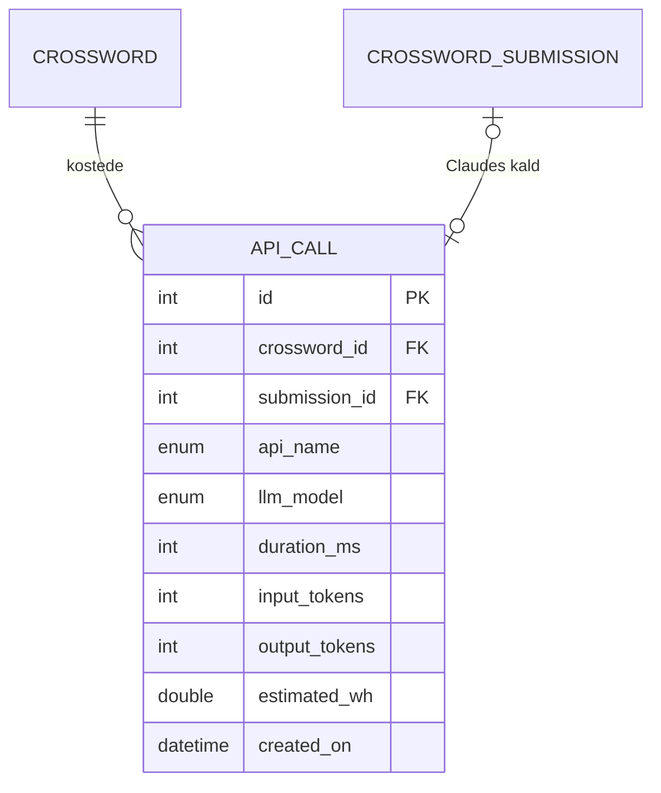

# Natlog 15. nov. 2026 – V2.0 og V3.0

Skrevet af Claude Code undervejs i natten. Tider er lokal tid (CET).

## Forløb (skrives løbende)

### Trin 0 – slice 3 kompilerer
- Start 01:05. Begge repos på `v2-v3-night` (tjekket med `git branch --show-current`).
- `./mvnw -q compile`: ingen fejl. Ingen rettelser, derfor intet rettelses-commit.
- Appen startet med `./mvnw spring-boot:run`, `GET /api/crosswords` svarede 200 med de gemte krydsord. Appen stoppet.
- Miljøvariabler: kun tjekket at navnene er sat (ja/nej), værdier ikke læst. `night.env` er ikke åbnet og ikke committet.
- Kort snak med Erik kl. ca. 01:08: integrationen med texs og Anthropic skal ikke testes i nat (svarformaterne kendes).
- Slut 01:10.

### Slice 4 – brugere
- Start 01:10.
- `spring-boot-starter-security` og `spring-security-test` (test-scope) tilføjet til pom.xml. Versioner styres af Spring Boot-parent.
- Nyt: `AppUserRepository` (findByUsername, existsByUsername), `SecurityConfig` (PasswordEncoder-bean med BCrypt
  + midlertidig minimal SecurityFilterChain, se beslutning 49), `AppUserDetailsService`, `UserService`,
  `UserController`, `UserRegistrationDto`, `UserDto`, `UsernameTakenException` (409), `InvalidRegistrationException` (400).
- `ControllerExceptionHandler`: nye handlers for 409/400, og `HttpMessageNotReadableException` → 400
  (manglende/ødelagt JSON-body gav ellers 500).
- Kompilering: ingen fejl i første forsøg.
- Kørt med curl (app startet og stoppet igen):
  - register → 201 `{"id":1,"username":"natbruger",...,"role":"PLAYER"}` uden hash
  - samme brugernavn igen → 409, blankt brugernavn → 400, manglende felter → 400, tom body → 400, password på 80 tegn → 400
  - `/me` med credentials → 200, uden → 401, forkert password → 401
- Hvor jeg gik i stå (ca. 2 min.): de første curl-kald gav 500. Årsagen var min test, ikke koden: i zsh splittes en
  variabel som `$J="-H Content-Type:..."` ikke i ord, så headeren blev sendt forkert. Med rigtig quoting virkede alt.
  Sidegevinst: en forkert Content-Type giver 500 i stedet for 415, fordi `everythingElse` fanger
  `HttpMediaTypeNotSupportedException`. Ikke rettet (findes også i V1, ikke en del af briefen) – noteret til Erik.
- Testbrugeren `natbruger` ligger nu i MySQL-tabellen `app_user` (der må ikke slettes i nat).
- Slut 01:13.

### Slice 5 – adgang
- Start 01:13.
- `SecurityConfig`: HTTP Basic, `SessionCreationPolicy.STATELESS`, CSRF slået fra (begrundet i kommentar), CORS via
  `CorsConfigurationSource`-bean for `http://localhost:63342` (GET, POST, OPTIONS; headers Authorization, Content-Type).
  Register og `/error` er åbne, alt andet kræver login.
- `@CrossOrigin` fjernet fra alle tre controllere (beslutning 53).
- `JsonAuthenticationEntryPoint`: 401 som JSON i `ErrorMessage`-formen, uden `WWW-Authenticate`. Bruges både af
  `httpBasic` (forkert password) og `exceptionHandling` (ingen credentials).
- Bruger sat på nye krydsord og afleveringer: controllerne tager `Principal`, services slår `AppUser` op via
  `UserService.findEntityByUsername`. Claude-afleveringer får den bruger, der bad Claude løse (beslutning 54).
  `SubmissionDto` har fået `username` (null for gamle afleveringer). `Crossword`-konstruktøren har fået `user`.
- Kompilering: ingen fejl.
- Kørt med curl:
  - `GET /api/crosswords` uden login → 401 JSON, ingen `WWW-Authenticate`, ingen `Set-Cookie`; med login → 200
  - `POST /api/crosswords` uden login → 401 (med login ikke kørt – det ville kalde texs)
  - `POST .../submissions/claude` uden login → 401 (med login ikke kørt – det ville kalde Anthropic)
  - forkert password → 401 JSON
  - preflight fra 63342 → 200 med `Access-Control-Allow-Origin/Methods/Headers`; fra fremmed origin → 403
  - spiller-aflevering med login → 201 med `"username":"natbruger"`; listen viser gamle afleveringer med `username: null`
  - register stadig åben → 201 (testbruger `natbruger2` oprettet)
- Fundet, ikke rettet: en ukendt sti med login (`/api/nothing`) giver 500 i stedet for 404, fordi `everythingElse`
  fanger `NoResourceFoundException`. Samme opførsel som før V2.0. Noteret til Erik.
- Slut 01:15.

### Slice 6 – login i frontend
- Start 01:15.
- Nyt i frontend: `js/auth.js` (credentials i en modul-variabel, beslutning 55), `js/components/authForms.js`
  (login- og registreringsformular). `crosswordApi.js`: `request()` sender `Authorization: Basic ...`, glemmer
  credentials og kalder en 401-handler ved 401; nye funktioner `registerUser` og `fetchMe`.
- `index.js`: siden starter med login. Login tjekkes med `GET /api/users/me`. Registrering logger ind bagefter.
  "Log ud" glemmer credentials. Enhver 401 viser login igen.
- Basic-headeren bygges fra UTF-8-bytes, fordi `btoa` ikke tåler æ/ø/å (beslutning 56).
- CSS: `[hidden] { display: none !important; }`, fordi `display: flex` ellers overstyrer `hidden`-attributten
  (fanget ved gennemlæsning, ikke i en browser).
- Afleveringslisten viser brugernavn (og "startet af" for Claude).
- Kørt: `node --check` på alle JS-filer (ok). Frontend er IKKE testet i en browser.
- Kørt med curl mod backend: register (med æøå i password) → 201, `/me` med UTF-8-Basic → 200, uden → 401,
  forkert password → 401, OPTIONS-preflight → CORS-headere, `POST /api/crosswords` uden login → 401.
- Ingen kald til texs eller Anthropic.
- Slut 01:17.

### Slice 7 – gitterstørrelser
- Start 01:17.
- Nye templates: `small-7x7`, `medium-9x9`, `large-13x13` (mini-5x5 uændret, id 1).
  - 7×7 er lavet i hånden. 9×9 og 13×13 er fundet med et lille Python-søgescript (hill-climbing over symmetriske
    par af sorte felter). Ingen ord er længere end 7 bogstaver for at gøre det lettere for texs (beslutning 57).
  - Kontrolleret to gange: et Python-tjek (180°-symmetri, ingen løb på 2, hver hvid celle i et ord ≥ 3, forbundet)
    og den rigtige `GridWordFinder` kørt via `jshell --class-path target/classes`:
    7×7: 22 ord, 3–7 bogstaver, 41/41 hvide celler dækket. 9×9: 30 ord, 3–6, 62/62. 13×13: 58 ord, 3–6, 135/135.
  - Krav om "ingen løb på 2" gælder kun de nye: mini-5x5 har løb på 2 i række 0 og 4 (ingen ord der, dækket lodret).
    Ikke ændret, fordi gemte krydsord peger på den.
- `InitData` tilføjer manglende templates efter navn (`existsByName`) og rører ikke eksisterende.
  Kørt: 1. start indsatte 3 rækker, 2. start indsatte 0.
- `GET /api/grid-templates` → `[{id,name,rows,cols}]` (ny `GridTemplateService`, `GridTemplateController`, `GridTemplateDto`).
- `POST /api/crosswords` tager `{gridTemplateId, playerPrompt}` (`CreateCrosswordRequestDto`). Templaten slås op før
  texs-kaldet, så et ukendt id giver 404 uden at bruge kvote. Tom playerPrompt gemmes som null.
  `findFirstByOrderByIdAsc` fjernet (ikke længere brugt).
- Kørt med curl: templates → 200 med 4 rækker, uden login → 401, ukendt id → 404, ingen body → 400, gammelt krydsord → 200.
  IKKE kørt: oprettelse med gyldigt id (ville kalde texs).
- **De nye templates er ikke testet mod texs** (dummy-nøgle). texs kan fejle på store gitre inden for `max_time` = 20 s
  (`CrosswordApiClient.MAX_SECONDS`), især 13×13. Fejler fill, svarer backenden 502 med texs' `reason`.
- Midlertidigt brud: frontendens "Hent nyt krydsord" sender ingen body og får 400, indtil slice 9 er committet.
- Slut 01:21.

### Slice 8 – tema i fritekst
- Start 01:21.
- Læst https://crossword.texs.org/crossword-api (kun dokumentationssiden, intet API-kald). Resultat:
  - `POST /fill` tager kun `grid`, `min_score`, `max_time` (1–30, standard 25), `language`, `try_hard_grid`.
    **Ingen parameter til tema eller ord, der skal med.** Man kan kun påvirke fyldet med faste bogstaver i gitteret.
  - `POST /fill/build` har `theme_words`, men kun for koreansk, kinesisk og japansk. `POST /fill/improve` har `locked`
    til at beskytte tema-celler, men kræver, at nogen først har valgt tema-ordene.
- Derfor: playerPrompt gemmes som krydsordets tema og vises (`CrosswordDto.theme`). **Brugerhistorien kan kun delvist
  opfyldes:** temaet påvirker ikke ordene. Claude genererer ikke ord eller gitter (beslutning 58).
- Tema over 255 tegn → 400 (`InvalidCrosswordRequestException`), tjekket før texs-kaldet (kolonnen er VARCHAR(255)).
- Kørt med curl: tema på 300 tegn → 400 uden texs-kald; `GET /api/crosswords/1` viser `"theme":null` for gamle krydsord.
- Slut 01:22.

### Slice 9 – frontend
- Start 01:22.
- `index.html` er bygget om i tydelige dele: landing-tekst (`.intro`), login/registrering, og efter login tre kort:
  "Nyt krydsord" (formular med gitterstørrelse og tema), "Gemte krydsord" (liste) og løsning, plus et kort med
  "Afleveringer".
- Inspiration fra `../kino_frontend`: `<nav aria-label>` i headeren, komponent-CSS i `css/components/` (her `grid.css`),
  små komponent-moduler. Ikke kopieret: kinos globale `transition: all` og `margin: auto` på alt.
- Ny komponent `templateSelect.js` fylder dropdown fra `GET /api/grid-templates` (vises som "9 × 9").
  `crosswordList.js` viser størrelse og tema på hver knap. Tema vises også over gitteret.
- 13×13: cellestørrelsen er `clamp(1.75rem, (100vw - 6.5rem) / kolonner, 3.25rem)`, og bogstaver og numre skalerer
  med cellen. På meget smalle skærme kan gitteret scrolles vandret (`.grid-scroll`) i stedet for at ødelægge siden.
- Kørt: `node --check` på alle 10 JS-filer (ok). Et script tjekker, at alle `querySelector("#...")` i `index.js` findes som
  id i `index.html` (ok). `auth.js` og `sizeLabel` er kørt i node: UTF-8-Basic-headeren matcher Node's egen Base64 (ok).
- **Ikke testet i en browser.** Layout, 13×13-visning og formularflow er kun skrevet og gennemlæst.
- Slut 01:24.

---

## 1. Status pr. slice

| Slice | Status | Kørt | Kun skrevet |
|---|---|---|---|
| Trin 0 | Lavet (ingen rettelser nødvendige) | compile, app-start, `GET /api/crosswords` | – |
| 4 Brugere | Lavet | compile, curl: register 201/409/400, `/me` 200/401 | – |
| 5 Adgang | Lavet | compile, curl: 401 JSON uden `WWW-Authenticate`/cookie, preflight, ejer på aflevering | `POST /api/crosswords` og Claude med login (ville kalde texs/Anthropic) |
| 6 Login i frontend | Lavet | `node --check`, curl-listen fra briefen, node-test af Basic-header | Hele browserflowet |
| 7 Gitterstørrelser | Lavet | compile, Python- og GridWordFinder-tjek af layouts, seeding to gange, curl: templates/404/400 | Fill af 7×7, 9×9, 13×13 mod texs |
| 8 Tema | Delvist (texs kan ikke tema) | docs læst, compile, curl: tema > 255 → 400, `theme` i DTO | Oprettelse med tema mod texs |
| 9 Frontend | Lavet | `node --check`, id-tjek, node-test af rene funktioner | Alt visuelt og i browser |

Ingen kald til texs eller Anthropic i nat. Ingen kompileringsfejl i nogen slice.

## 2. Beslutninger (Afventer Erik)

**49. Minimal SecurityFilterChain allerede i slice 4**
- Valg: Slice 4 fik en lille kæde (CSRF fra, register åben, Basic). Slice 5 gjorde den færdig.
- Begrundelse: Med kun startern slår Spring Boot form-login og CSRF til, så `POST /register` kunne ikke testes med curl.
- Fravalgt: At vente med kæden til slice 5 og lade slice 4 være utestet.
- Status: Afventer Erik

**50. Brugernavn tjekkes to gange**
- Valg: `existsByUsername` før gem, og `DataIntegrityViolationException` fra unique-kolonnen oversættes også til 409.
- Begrundelse: To samtidige registreringer kan begge passere det første tjek. Kolonnen er den rigtige garanti.
- Fravalgt: Kun unique-kolonnen (giver 500) eller kun tjekket (race condition).
- Status: Afventer Erik

**51. Password over 72 bytes → 400, ingen minimumslængde**
- Valg: Max 72 bytes (BCrypt bruger kun de første 72, og Springs encoder afviser længere). Ingen minimumslængde.
- Begrundelse: Briefen kræver kun 400 ved tomme felter. 72-grænsen forhindrer en 500.
- Fravalgt: Minimumslængde/kompleksitetskrav (ikke i briefen), eller at lade BCrypt kaste en 500.
- Status: Afventer Erik

**52. Manglende/ødelagt JSON-body → 400**
- Valg: `HttpMessageNotReadableException` håndteres i `ControllerExceptionHandler`.
- Begrundelse: Ellers fanger `everythingElse` den og svarer 500 på en klientfejl.
- Fravalgt: Validation-starteren (`@Valid`) – ny afhængighed.
- Status: Afventer Erik

**53. CORS flyttet til SecurityConfig, `@CrossOrigin` fjernet**
- Valg: Én `CorsConfigurationSource` for `/api/**`, kun origin `http://localhost:63342`, metoder GET/POST/OPTIONS,
  headers Authorization/Content-Type.
- Begrundelse: Preflight skal besvares før login-tjekket, og ét sted bestemmer reglen. Tidligere tillod `@CrossOrigin` alle origins.
- Fravalgt: `@CrossOrigin` på controllerne + `http.cors()` (to steder at holde i sync).
- Status: Afventer Erik

**54. Claude-afleveringer får brugeren, der bad Claude løse**
- Valg: `CrosswordSubmission.user` = den indloggede bruger, også når `llmModel` er sat. Frontend viser "startet af".
- Begrundelse: Viser, hvem der har brugt penge på Claude-kald.
- Fravalgt: `user = null` for Claude.
- Status: Afventer Erik

**55. Credentials kun i hukommelsen**
- Valg: Basic-headeren ligger i en variabel i `js/auth.js`. Genindlæsning = log ind igen.
- Begrundelse: localStorage kan læses af ethvert script på siden og overlever lukning af browseren.
- Fravalgt: localStorage og sessionStorage.
- Status: Afventer Erik

**56. Basic-header bygges fra UTF-8**
- Valg: `TextEncoder` → bytes → `btoa`.
- Begrundelse: `btoa("blåbær")` kaster en fejl. Spring læser Basic som UTF-8 (testet med curl og æøå).
- Fravalgt: Ren `btoa` (fejler på æ/ø/å).
- Status: Afventer Erik

**57. Templates: 7×7, 9×9 og 13×13 uden løb på 2 og uden ord over 7 bogstaver**
- Valg: Tre nye layouts. 9×9 og 13×13 er fundet med søgescript, 7×7 er lavet i hånden.
- Begrundelse: 13×13 viser maks-størrelsen. Korte ord gør det lettere for texs at fylde. Et løb på 2 ville ligne et ord uden ledetråd.
- Fravalgt: 11×11 (holdt antallet nede), mere åbne gitre med ord på 8+ bogstaver (søgningen fandt dem, men de er sværere at fylde).
- Status: Afventer Erik

**58. Tema gemmes og vises, men styrer ikke ordene**
- Valg: playerPrompt gemmes og sendes som `CrosswordDto.theme`.
- Begrundelse: texs' `/fill` har ingen tema-parameter. Claude må ikke lave ord eller gitter.
- Fravalgt: Faste bogstaver fra spillerens egne ord i gitteret (ny feature, og hvem placerer dem?),
  `/fill/build` med `theme_words` (kun koreansk, kinesisk, japansk), Claude-genererede temaord (afvist af Erik).
- Status: Afventer Erik

**59. `gridTemplateId` er `int`**
- Valg: Mangler feltet, bliver det 0 og giver 404 "No grid template with id 0".
- Begrundelse: Følger reglen om, at id'er er `int`, og der bruges ingen kvote.
- Fravalgt: `Integer` + null-tjek for en pænere 400.
- Status: Afventer Erik

**60. Tema maks 255 tegn**
- Valg: 400 hvis længere. Tjekkes før texs-kaldet.
- Begrundelse: Kolonnen er VARCHAR(255). Ellers ville fejlen komme efter, at en fill var brugt.
- Fravalgt: At ændre kolonnen til TEXT (kræver skemaændring på eksisterende tabel).
- Status: Afventer Erik

**61. Alt under `/api/**` undtagen register kræver login, også GET**
- Valg: `anyRequest().authenticated()`.
- Begrundelse: Det, briefen beder om. Det enkleste og sikreste.
- Fravalgt: Offentlige GET-endpoints til liste og templates.
- Status: Afventer Erik

**62. Alle krydsord er fælles**
- Valg: Alle indloggede kan se og løse alle krydsord og se alle afleveringer. Kun ejer gemmes.
- Begrundelse: Briefen kræver kun, at brugeren sættes. Filtrering pr. bruger er en ny feature.
- Fravalgt: "Kun mine krydsord".
- Status: Afventer Erik

**63. Samme 401-tekst for ukendt bruger og forkert password**
- Valg: "Login required" i begge tilfælde.
- Begrundelse: Man kan ikke bruge svaret til at finde ud af, hvilke brugernavne der findes.
- Fravalgt: Separate beskeder. Bemærk dog, at `/register` med 409 stadig afslører, om et navn er taget.
- Status: Afventer Erik

**64. Fundne fejl ikke rettet**
- Valg: En forkert Content-Type (burde give 415) og en ukendt sti (burde give 404) giver 500 via `everythingElse`. Ikke rettet.
- Begrundelse: Fejlene fandtes allerede før i nat, og rettelserne står ikke i briefen.
- Fravalgt: To ekstra handlers (`HttpMediaTypeNotSupportedException`, `NoResourceFoundException`).
- Status: Afventer Erik

## 3. Refleksionsspørgsmål

### V2.0 – Spring Security
1. `SecurityConfig` slår CSRF fra. Hvilket konkret angreb beskytter CSRF-tokens mod? Hvorfor rammer det ikke os, så længe
   frontend sender Basic-headeren selv? Hvad ville ændre sig, hvis vi skiftede til session-cookies?
2. `JsonAuthenticationEntryPoint` sætter ikke `WWW-Authenticate`. Hvad gør browseren, hvis headeren er der? Hvorfor ser
   `ControllerExceptionHandler` aldrig en 401 fra et manglende login? (Tip: hvor i kæden kører filteret?)
3. HTTP Basic sender brugernavn og password med hver request, kun Base64-kodet. Hvad betyder det uden HTTPS? Hvad ville
   du ændre, før appen kom på nettet?
4. `UserService.register` tjekker `existsByUsername` og fanger alligevel `DataIntegrityViolationException`. Beskriv det
   scenarie, hvor tjekket alene ikke er nok.
5. Hvorfor gemmer vi en BCrypt-hash og ikke fx SHA-256 af passwordet? Hvad sker der med et password på 100 tegn, og hvorfor
   har vi et tjek for 72 bytes?
6. Preflight (OPTIONS) sendes uden `Authorization`. Hvad ville brugeren se i browseren, hvis `.cors(...)` manglede i
   kæden, og det kun var `anyRequest().authenticated()`, der svarede?
7. Controllerne bruger `Principal` til at finde brugeren, aldrig et brugernavn fra body'en. Hvad kunne en angriber gøre,
   hvis `SubmissionRequestDto` havde et `username`-felt, som vi stolede på?
8. `ControllerExceptionHandler.everythingElse` returnerer `ex.getMessage()` til klienten. Hvilke informationer kunne det
   lække (fx fra databasen)? Hvordan ville du lukke det uden at miste fejlsøgning?

### V3.0 – mere interessant frontend
1. `CrosswordService.createCrossword` slår templaten op og tjekker temaets længde før `apiClient.fill`. Hvad koster det,
   hvis rækkefølgen var omvendt, og et kald fejlede bagefter?
2. Brugerhistorien om tema kan kun delvist opfyldes. Hvordan forklarer du forskellen på "temaet gemmes og vises" og
   "temaet styrer ordene"? Hvilke muligheder giver texs-dokumentationen, og hvorfor er de fravalgt?
3. `InitData` matcher templates på navn. Hvad sker der, hvis nogen retter layoutet for `small-7x7` i koden? Hvad sker der
   med de krydsord, der allerede peger på den?
4. Hvorfor må et layout ikke have et løb på 2 hvide felter? Hvad ville `GridWordFinder` gøre med det, og hvad ville
   spilleren opleve?
5. texs har `max_time` på højst 30 sekunder, og vi sender 20. Hvad sker der i backend og frontend, når et 13×13 ikke kan
   fyldes? Hvilken HTTP-status får frontend, og hvorfor?
6. `.grid` beregner `--cell-size` med `clamp()` og `var(--columns)`. Hvorfor sættes `--columns` fra JavaScript og ikke i
   CSS'en? Hvad sker der på en 360 px bred telefon med 13×13?
7. Temaet er fri tekst, der vises på siden. Hvorfor er det sikkert, at `crosswordList.js` bruger `textContent` og ikke
   `innerHTML`? Hvad kunne en anden bruger ellers gøre med sit tema?

## 4. Ændrede filer pr. commit

Backend (`crosswords_backend`, branch `v2-v3-night`):
- `3855b59` Slice 4: pom.xml, SecurityConfig, UserController, UserDto, UserRegistrationDto, ControllerExceptionHandler,
  InvalidRegistrationException, UsernameTakenException, AppUser, AppUserRepository, AppUserDetailsService, UserService, docs/natlog.md
- `c4f40fe` Slice 5: JsonAuthenticationEntryPoint, SecurityConfig, CrosswordController, SubmissionController, UserController,
  CrosswordMapper, SubmissionDto, SubmissionMapper, Crossword, CrosswordSubmission, CrosswordService, SubmissionService, docs/natlog.md
- `47f9b3f` Slice 6 (natlog): docs/natlog.md
- `b1ed66c` Slice 7: InitData, CrosswordController, GridTemplateController, CreateCrosswordRequestDto, CrosswordMapper,
  GridTemplateDto, GridTemplateRepository, CrosswordService, GridTemplateService, docs/natlog.md
- `d52115c` Slice 8: CrosswordDto, CrosswordMapper, ControllerExceptionHandler, InvalidCrosswordRequestException, Crossword,
  CrosswordService, docs/natlog.md
- Afsluttende commit: docs/natlog.md, requests.http (Basic-header og ny body på alle eksempler)

Frontend (`crosswords_frontend`, branch `v2-v3-night`):
- `c3f3521` Slice 6: index.html, css/stylesheet.css, js/index.js, js/auth.js, js/api/crosswordApi.js,
  js/components/authForms.js, js/components/submissionList.js
- `a3df5a2` Slice 9: index.html, css/stylesheet.css, css/components/grid.css, js/index.js, js/api/crosswordApi.js,
  js/components/crosswordList.js, js/components/templateSelect.js

Ikke committet: `CLAUDE.md`, `NATBRIEF.md`, `night.env` (untracked, rørt ikke).

## 5. Hvad Erik skal gøre manuelt i morgen

- **Ingen DROP nødvendig.** Der er ingen nye kolonner: `user_id`, `player_prompt` og tabellen `app_user` fandtes allerede.
  `ddl-auto=update` har ikke ændret noget. Templates seedes automatisk ved start.
- **Testdata fra i nat**, som du kan slette, hvis du vil (jeg må ikke):
  `app_user`: `natbruger`, `natbruger2`, `natbruger3`. `crossword_submission` id 5 (spiller-aflevering på krydsord 1 med 0 %).
  Fx `DELETE FROM crossword_submission WHERE id = 5;` og
  `DELETE FROM app_user WHERE username IN ('natbruger','natbruger2','natbruger3');` (slet afleveringen først pga. fremmednøglen).
- **Ingen nye miljøvariabler.**
- **`night.env`** er untracked, men står ikke i `.gitignore`. Overvej at tilføje den, så den ikke ryger med i et commit.
- **Anthropic-auth:** `WebClientConfig.claudeWebClient` sender `Authorization: Bearer <key>`. Anthropics API plejer at
  forvente `x-api-key: <key>`. Det er ikke ændret (aftalt med dig kl. ca. 01:08). Tjek med rigtig nøgle, før du præsenterer.
- **Test med rigtig texs-nøgle** (koster fills): opret ét krydsord af hver ny størrelse (7×7, 9×9, 13×13). Fejler 13×13,
  så overvej `max_time` 30 og/eller `try_hard_grid` i `FillRequest`. Det er ikke ændret, fordi det ikke står i briefen.
- **Browsertest af frontend** (port 63342): opret bruger, log ind, forkert password, log ud, genindlæs (skal kræve login),
  opret krydsord med og uden tema, vælg 13×13 og tjek layoutet på smal og bred skærm, tjek løsning, lad Claude løse.
- Gamle krydsord og afleveringer har `user = null`. De vises som "Ukendt spiller" og uden tema.

## 6. Procesdata til præsentationen

- **Tidsforbrug:** 01:05–01:26, ca. 21 minutter. Trin 0: 5 min (inkl. kort snak med Erik). Slice 4: 3 min. Slice 5: 2 min.
  Slice 6: 2 min. Slice 7: 4 min. Slice 8: 1 min. Slice 9: 2 min. Natlog og afslutning: 2 min.
  (Tiderne er klokkeslæt fra `date` undervejs. Det meste af tiden gik med at vente på app-start og compile.)
- **Kompileringsfejl:** Ingen, heller ikke i slice 3, der aldrig havde været kompileret.
- **Fejl og blokeringer:**
  - Slice 4: curl gav 500 i ca. 2 minutter. Det var min fejl: zsh splitter ikke `$J` i ord, så Content-Type-headeren
    var forkert. Fandt som sidegevinst, at en forkert Content-Type giver 500 (beslutning 64).
  - Slice 7: At finde symmetriske layouts uden løb på 2 i hånden fungerede ikke for 9×9 (mit første forsøg havde et løb
    på 2 i kolonne 3). Skiftede til et søgescript. Den første 13×13-søgning gav meget åbne gitre (ord på 8 bogstaver),
    så den blev kørt igen med maks 6.
  - Slice 6/9: Ved gennemlæsning så jeg, at `display: flex` overstyrer `hidden`. Rettet med en global `[hidden]`-regel.
- **Hvad jeg ville have spurgt Erik om** (svarene står nu som "Afventer Erik"):
  - Skal krydsord være fælles for alle eller pr. bruger (62)? Skal GET-endpoints være offentlige (61)?
  - Er det i orden, at temaet kun vises, og vil du hellere have, at spilleren kan skrive ord ind, som låses i gitteret (58)?
  - Hvilke størrelser vil du have, og er 13×13 realistisk hos texs inden for 20 sekunder (57)?
  - Skal de to 500-fejl (415/404) rettes nu eller i V5.0 sammen med tests (64)?

---

# Del 2 – V4.0 til V6.0 (samme nat)

Erik gav kl. ca. 01:27 lov til at fortsætte i roadmap'en til og med V6.0 og pegede på kino-projektet for CI/CD.
Det tilsidesætter linjen "Ikke nu: ... (V4.0), (V5.0), (V6.0)" i CLAUDE.md for denne session. V7.0 (Docker) og
senere er ikke rørt. Roadmap'en er læst i Notion ("3. semester - AI projekt" → Product Roadmap):
- V4.0 større ERD: tabel med estimeret ressourceforbrug pr. API-kald vs. menneskets energiforbrug; brug af roles – hvad kan en admin?
- V5.0 H2 og unit test.
- V6.0 CI/CD: simpel og effektiv brug af Spring profiles til dev og prod.
Kino-referencen: `kino_backend/.github/workflows` (maven-test som genbrugelig workflow, run-tests på push/PR,
release + GHCR) og profilerne dev/prod/runnertest/test. Kun workflow-, properties- og testfiler er læst – ikke `.env`.

### Hændelse ca. 01:30 – Erik kunne ikke kompilere
- Erik byggede fra arbejdskopien, mens slice 10 var halvfærdig: `ClaudeApiClient` returnerede allerede `ClaudeSolution`,
  men `SubmissionService` forventede stadig `List<String>`. Det committede var fint.
- Rettet med det samme. Lære: kompilér efter hver filændring, ikke kun ved slicens afslutning. Gjort sådan resten af natten.
- Erik spurgte også, hvorfor han ikke så frontend-ændringer: IntelliJ's Changes-vindue er tomt, fordi alt var committet.

### Slice 10 – ressourceforbrug pr. API-kald (V4.0)
- Start 01:28 (afbrudt af hændelsen ovenfor).
- Ny tabel `api_call` (entity `ApiCall`): crossword (FK, påkrævet), submission (FK, kun Claude), `apiName`
  (`ExternalApi`: TEXS_FILL, TEXS_CLUES, CLAUDE_SOLVE), `llmModel`, `durationMs`, `inputTokens`, `outputTokens`,
  `estimatedWh`, `createdOn`.
- Energi = watt × tid, ens for mennesker og maskiner (`EnergyEstimator`, beslutning 65). Hjerne 20 W, texs 50 W,
  Claude 300/700/1400 W pr. model (`ClaudeModel.estimatedWatts`). Tid og tokens er målt; watt er antaget.
- `ClaudeResponse` læser nu `usage.input_tokens/output_tokens`. `ClaudeApiClient.solveCrossword` returnerer `ClaudeSolution`
  (grid + tokens).
- `CrosswordService` måler fill og clues og gemmer to rækker efter krydsordet. `SubmissionService` gemmer én række pr.
  Claude-løsning, koblet til afleveringen. `scoreAndSave` er delt i `markCells`, `save` og `toResult`, så Claude-rækken
  kan pege på den gemte aflevering.
- `SubmissionDto.estimatedWh` beregnes fra den gemte tid (spiller: hjerne, Claude: modellen), så der ikke skal slås op.
- `GET /api/crosswords/{id}/api-calls` → liste af `ApiCallDto`. 404 for ukendt krydsord.
- Frontend: tabel "Ressourceforbrug" under afleveringer (`resourceTable.js`, `energy.js`) med en række pr. kald og en
  række pr. spiller-aflevering. Afleveringslisten viser "≈ 5,6 mWh".
- Kørt: compile, curl (`/api-calls` → `[]` for krydsord 1 og 404 for ukendt, `estimatedWh` i afleveringer:
  spiller 1 s → 0,0056 Wh, Haiku 13,9 s → 1,16 Wh), Hibernate oprettede `api_call`. `node --check` og id-tjek ok,
  `formatWh` testet i node.
- IKKE kørt: selve optagelsen af texs- og Claude-kald (kræver eksterne kald). Dækkes af tests med mocks i V5.0.
- Opdaget: Hibernate 7 laver MySQL-kolonner af typen `enum('A','B',...)` for `@Enumerated(STRING)`.
  Tilføjes en ny værdi til fx `ClaudeModel`, opdaterer `ddl-auto=update` ikke kolonnen → indsættelse fejler.
  Gælder også den eksisterende `llm_model`. Noteret til Erik.
- Begrænsning: et Claude-svar, der ikke kan bruges (`ClaudeAnswerException`), optages ikke, selvom tokens er brugt.
- Slut 01:41.

ERD efter V4.0 (nye/ændrede dele):

### Slice 11 – roller: hvad kan en admin? (V4.0)
- Start 01:41.
- Svar på roadmap'ens spørgsmål (beslutning 66): en ADMIN kan
  1. se alle brugere (`GET /api/admin/users`),
  2. se den samlede regning pr. API: antal kald, tid, tokens og estimeret energi (`GET /api/admin/usage`,
     JPQL med `select new ...ApiUsageSummaryDto(...) group by`),
  3. som den eneste starte `TOTAL_TOKEN_KILLER` (`ClaudeModel.adminOnly`). En PLAYER får 403, før Claude kaldes.
- `/api/admin/**` kræver `hasRole("ADMIN")` i `SecurityConfig`. Ny `JsonAccessDeniedHandler` svarer 403 som JSON.
  Det admin-låste model-valg tjekkes i `SubmissionService` med rollen fra databasen → `ModelNotAllowedException` → 403.
- Ingen måde at blive admin på via API'et. Det sker kun med SQL (beslutning 67), og ingen admin er seedet med password.
- Frontend: admin-panel (samlet forbrug + brugere) vises kun for ADMIN. Fable-valget er slået fra for spillere.
  Det er kun bekvemmelighed; backenden afviser alligevel. `API_NAMES` er flyttet til `models.js`, så den kun står ét sted.
- Kørt: compile, app-start (Spring Data validerer JPQL-forespørgslen ved opstart → ok), curl: player på
  `/api/admin/users` → 403 JSON, uden login → 401, Fable som player → 403 "Only an admin may use TOTAL_TOKEN_KILLER"
  uden Claude-kald, Haiku på ukendt krydsord → 404. `node --check` og id-tjek ok.
- IKKE kørt mod MySQL: en rigtig admin (kræver `UPDATE app_user SET role = 'ADMIN'`, og miljøvariablerne til databasen
  må jeg ikke bruge). Admin-stien testes med MockMvc og H2 i V5.0.
- Slut 01:45.

### Slice 12 – H2 og tests (V5.0)
- Start 01:45.
- Ingen nye afhængigheder: H2 lå allerede i pom.xml (runtime), og `spring-security-test` kom med i slice 4.
  `@AutoConfigureMockMvc` kører Spring Security-filtrene med (bevist af 401/403-testene).
- `src/test/resources/application-test.properties`: H2 i hukommelsen med `MODE=MySQL`, `create-drop`, dummy-nøgler
  og base-URL'er på port 1. Hver Spring-kontekst får sin egen database (`${random.uuid}`), så kontekster ikke sletter
  hinandens tabeller.
- 47 tests, alle grønne (`./mvnw test`, ca. 15 s, ingen MySQL, intet netværk):
  - `GridScorerTest` (6): rigtig/forkert/tom/sort celle, små bogstaver, procent uden sorte felter, forkert størrelse → fejl.
  - `GridWordFinderTest` (2): nummerering som i et trykt krydsord, løb under 3 ignoreres.
  - `InitDataTemplatesTest` (16, parametriseret over alle 4 templates): ens rækkelængde, 180°-symmetri, hver hvid celle
    i et ord, højst 13×13. Erstatter mit Python-tjek fra slice 7 med en test, der kører hver gang.
  - `EnergyEstimatorTest` (3).
  - `SecurityIntegrationTest` (12): register 201 uden hash, 409, 400; 401 som JSON uden `WWW-Authenticate`; forkert
    password; ingen `Set-Cookie`; oprettelse kræver login (og texs kaldes ikke); preflight ok fra 63342 og 403 fra fremmed
    origin; player → admin 403; admin → 200; player + TOTAL_TOKEN_KILLER → 403 og Claude kaldes aldrig.
  - `CrosswordFlowIntegrationTest` (7, texs og Claude mocket med `@MockitoBean`): svaret indeholder ingen facit-rækker
    eller facit-ord; Claude får kun `.` og `#` (ArgumentCaptor); score 100 % for Claude og 91 % for en spiller med to fejl;
    texs- og Claude-kald optages med tokens; ukendt template → 404 uden texs-kald; admin må bruge Fable; forkert størrelse → 400.
  - `CrosswordsBackendApplicationTests.contextLoads` kører nu med profilen `test`.
- **Fejl fundet af testene:** `InitData.TEMPLATES` var en statisk liste af entity-objekter. `save()` sætter id på objektet,
  så den næste Spring-kontekst i samme JVM prøvede at gemme "allerede gemte" objekter → `StaleObjectStateException`.
  Rettet: `InitData.templates()` laver nye objekter ved hvert kald. Kunne i princippet også ramme en devtools-genstart.
- **Mutationstest:** `blankOut` midlertidigt ændret til at returnere gitteret uændret → 2 tests fejlede
  ("answer row leaked", "Claude saw letters"). Ændringen er fjernet igen med `git checkout -- CrosswordService.java`
  (filen var uændret i forvejen). Testene vogter altså reelt facit-reglen.
- Slut 01:58.
