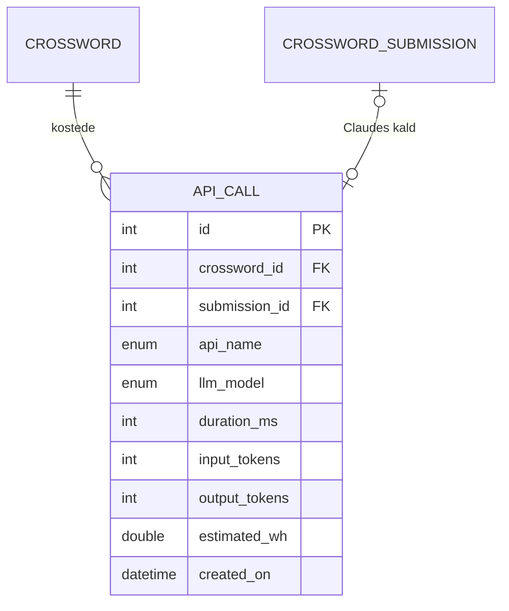

# Natlog 15. nov. 2026 – V2.0 og V3.0

Skrevet af Claude Code undervejs i natten. Tider er lokal tid (CET).

## Forløb (skrives løbende)

### Trin 0 – slice 3 kompilerer
- Start 01:05. Begge repos på `v2-v3-night` (tjekket med `git branch --show-current`).
- `./mvnw -q compile`: ingen fejl. Ingen rettelser, derfor intet rettelses-commit.
- Appen startet med `./mvnw spring-boot:run`, `GET /api/crosswords` svarede 200 med de gemte krydsord. Appen stoppet.
- Miljøvariabler: kun tjekket at navnene er sat (ja/nej), værdier ikke læst. `night.env` er ikke åbnet og ikke committet.
- Kort snak med Erik kl. ca. 01:08: integrationen med texs og Anthropic skal ikke testes i nat (svarformaterne kendes).
- Slut 01:10.

### Slice 4 – brugere
- Start 01:10.
- `spring-boot-starter-security` og `spring-security-test` (test-scope) tilføjet til pom.xml. Versioner styres af Spring Boot-parent.
- Nyt: `AppUserRepository` (findByUsername, existsByUsername), `SecurityConfig` (PasswordEncoder-bean med BCrypt
  + midlertidig minimal SecurityFilterChain, se beslutning 49), `AppUserDetailsService`, `UserService`,
  `UserController`, `UserRegistrationDto`, `UserDto`, `UsernameTakenException` (409), `InvalidRegistrationException` (400).
- `ControllerExceptionHandler`: nye handlers for 409/400, og `HttpMessageNotReadableException` → 400
  (manglende/ødelagt JSON-body gav ellers 500).
- Kompilering: ingen fejl i første forsøg.
- Kørt med curl (app startet og stoppet igen):
  - register → 201 `{"id":1,"username":"natbruger",...,"role":"PLAYER"}` uden hash
  - samme brugernavn igen → 409, blankt brugernavn → 400, manglende felter → 400, tom body → 400, password på 80 tegn → 400
  - `/me` med credentials → 200, uden → 401, forkert password → 401
- Hvor jeg gik i stå (ca. 2 min.): de første curl-kald gav 500. Årsagen var min test, ikke koden: i zsh splittes en
  variabel som `$J="-H Content-Type:..."` ikke i ord, så headeren blev sendt forkert. Med rigtig quoting virkede alt.
  Sidegevinst: en forkert Content-Type giver 500 i stedet for 415, fordi `everythingElse` fanger
  `HttpMediaTypeNotSupportedException`. Ikke rettet (findes også i V1, ikke en del af briefen) – noteret til Erik.
- Testbrugeren `natbruger` ligger nu i MySQL-tabellen `app_user` (der må ikke slettes i nat).
- Slut 01:13.

### Slice 5 – adgang
- Start 01:13.
- `SecurityConfig`: HTTP Basic, `SessionCreationPolicy.STATELESS`, CSRF slået fra (begrundet i kommentar), CORS via
  `CorsConfigurationSource`-bean for `http://localhost:63342` (GET, POST, OPTIONS; headers Authorization, Content-Type).
  Register og `/error` er åbne, alt andet kræver login.
- `@CrossOrigin` fjernet fra alle tre controllere (beslutning 53).
- `JsonAuthenticationEntryPoint`: 401 som JSON i `ErrorMessage`-formen, uden `WWW-Authenticate`. Bruges både af
  `httpBasic` (forkert password) og `exceptionHandling` (ingen credentials).
- Bruger sat på nye krydsord og afleveringer: controllerne tager `Principal`, services slår `AppUser` op via
  `UserService.findEntityByUsername`. Claude-afleveringer får den bruger, der bad Claude løse (beslutning 54).
  `SubmissionDto` har fået `username` (null for gamle afleveringer). `Crossword`-konstruktøren har fået `user`.
- Kompilering: ingen fejl.
- Kørt med curl:
  - `GET /api/crosswords` uden login → 401 JSON, ingen `WWW-Authenticate`, ingen `Set-Cookie`; med login → 200
  - `POST /api/crosswords` uden login → 401 (med login ikke kørt – det ville kalde texs)
  - `POST .../submissions/claude` uden login → 401 (med login ikke kørt – det ville kalde Anthropic)
  - forkert password → 401 JSON
  - preflight fra 63342 → 200 med `Access-Control-Allow-Origin/Methods/Headers`; fra fremmed origin → 403
  - spiller-aflevering med login → 201 med `"username":"natbruger"`; listen viser gamle afleveringer med `username: null`
  - register stadig åben → 201 (testbruger `natbruger2` oprettet)
- Fundet, ikke rettet: en ukendt sti med login (`/api/nothing`) giver 500 i stedet for 404, fordi `everythingElse`
  fanger `NoResourceFoundException`. Samme opførsel som før V2.0. Noteret til Erik.
- Slut 01:15.

### Slice 6 – login i frontend
- Start 01:15.
- Nyt i frontend: `js/auth.js` (credentials i en modul-variabel, beslutning 55), `js/components/authForms.js`
  (login- og registreringsformular). `crosswordApi.js`: `request()` sender `Authorization: Basic ...`, glemmer
  credentials og kalder en 401-handler ved 401; nye funktioner `registerUser` og `fetchMe`.
- `index.js`: siden starter med login. Login tjekkes med `GET /api/users/me`. Registrering logger ind bagefter.
  "Log ud" glemmer credentials. Enhver 401 viser login igen.
- Basic-headeren bygges fra UTF-8-bytes, fordi `btoa` ikke tåler æ/ø/å (beslutning 56).
- CSS: `[hidden] { display: none !important; }`, fordi `display: flex` ellers overstyrer `hidden`-attributten
  (fanget ved gennemlæsning, ikke i en browser).
- Afleveringslisten viser brugernavn (og "startet af" for Claude).
- Kørt: `node --check` på alle JS-filer (ok). Frontend er IKKE testet i en browser.
- Kørt med curl mod backend: register (med æøå i password) → 201, `/me` med UTF-8-Basic → 200, uden → 401,
  forkert password → 401, OPTIONS-preflight → CORS-headere, `POST /api/crosswords` uden login → 401.
- Ingen kald til texs eller Anthropic.
- Slut 01:17.

### Slice 7 – gitterstørrelser
- Start 01:17.
- Nye templates: `small-7x7`, `medium-9x9`, `large-13x13` (mini-5x5 uændret, id 1).
  - 7×7 er lavet i hånden. 9×9 og 13×13 er fundet med et lille Python-søgescript (hill-climbing over symmetriske
    par af sorte felter). Ingen ord er længere end 7 bogstaver for at gøre det lettere for texs (beslutning 57).
  - Kontrolleret to gange: et Python-tjek (180°-symmetri, ingen løb på 2, hver hvid celle i et ord ≥ 3, forbundet)
    og den rigtige `GridWordFinder` kørt via `jshell --class-path target/classes`:
    7×7: 22 ord, 3–7 bogstaver, 41/41 hvide celler dækket. 9×9: 30 ord, 3–6, 62/62. 13×13: 58 ord, 3–6, 135/135.
  - Krav om "ingen løb på 2" gælder kun de nye: mini-5x5 har løb på 2 i række 0 og 4 (ingen ord der, dækket lodret).
    Ikke ændret, fordi gemte krydsord peger på den.
- `InitData` tilføjer manglende templates efter navn (`existsByName`) og rører ikke eksisterende.
  Kørt: 1. start indsatte 3 rækker, 2. start indsatte 0.
- `GET /api/grid-templates` → `[{id,name,rows,cols}]` (ny `GridTemplateService`, `GridTemplateController`, `GridTemplateDto`).
- `POST /api/crosswords` tager `{gridTemplateId, playerPrompt}` (`CreateCrosswordRequestDto`). Templaten slås op før
  texs-kaldet, så et ukendt id giver 404 uden at bruge kvote. Tom playerPrompt gemmes som null.
  `findFirstByOrderByIdAsc` fjernet (ikke længere brugt).
- Kørt med curl: templates → 200 med 4 rækker, uden login → 401, ukendt id → 404, ingen body → 400, gammelt krydsord → 200.
  IKKE kørt: oprettelse med gyldigt id (ville kalde texs).
- **De nye templates er ikke testet mod texs** (dummy-nøgle). texs kan fejle på store gitre inden for `max_time` = 20 s
  (`CrosswordApiClient.MAX_SECONDS`), især 13×13. Fejler fill, svarer backenden 502 med texs' `reason`.
- Midlertidigt brud: frontendens "Hent nyt krydsord" sender ingen body og får 400, indtil slice 9 er committet.
- Slut 01:21.

### Slice 8 – tema i fritekst
- Start 01:21.
- Læst https://crossword.texs.org/crossword-api (kun dokumentationssiden, intet API-kald). Resultat:
  - `POST /fill` tager kun `grid`, `min_score`, `max_time` (1–30, standard 25), `language`, `try_hard_grid`.
    **Ingen parameter til tema eller ord, der skal med.** Man kan kun påvirke fyldet med faste bogstaver i gitteret.
  - `POST /fill/build` har `theme_words`, men kun for koreansk, kinesisk og japansk. `POST /fill/improve` har `locked`
    til at beskytte tema-celler, men kræver, at nogen først har valgt tema-ordene.
- Derfor: playerPrompt gemmes som krydsordets tema og vises (`CrosswordDto.theme`). **Brugerhistorien kan kun delvist
  opfyldes:** temaet påvirker ikke ordene. Claude genererer ikke ord eller gitter (beslutning 58).
- Tema over 255 tegn → 400 (`InvalidCrosswordRequestException`), tjekket før texs-kaldet (kolonnen er VARCHAR(255)).
- Kørt med curl: tema på 300 tegn → 400 uden texs-kald; `GET /api/crosswords/1` viser `"theme":null` for gamle krydsord.
- Slut 01:22.

### Slice 9 – frontend
- Start 01:22.
- `index.html` er bygget om i tydelige dele: landing-tekst (`.intro`), login/registrering, og efter login tre kort:
  "Nyt krydsord" (formular med gitterstørrelse og tema), "Gemte krydsord" (liste) og løsning, plus et kort med
  "Afleveringer".
- Inspiration fra `../kino_frontend`: `<nav aria-label>` i headeren, komponent-CSS i `css/components/` (her `grid.css`),
  små komponent-moduler. Ikke kopieret: kinos globale `transition: all` og `margin: auto` på alt.
- Ny komponent `templateSelect.js` fylder dropdown fra `GET /api/grid-templates` (vises som "9 × 9").
  `crosswordList.js` viser størrelse og tema på hver knap. Tema vises også over gitteret.
- 13×13: cellestørrelsen er `clamp(1.75rem, (100vw - 6.5rem) / kolonner, 3.25rem)`, og bogstaver og numre skalerer
  med cellen. På meget smalle skærme kan gitteret scrolles vandret (`.grid-scroll`) i stedet for at ødelægge siden.
- Kørt: `node --check` på alle 10 JS-filer (ok). Et script tjekker, at alle `querySelector("#...")` i `index.js` findes som
  id i `index.html` (ok). `auth.js` og `sizeLabel` er kørt i node: UTF-8-Basic-headeren matcher Node's egen Base64 (ok).
- **Ikke testet i en browser.** Layout, 13×13-visning og formularflow er kun skrevet og gennemlæst.
- Slut 01:24.

---

## 1. Status pr. slice

| Slice | Status | Kørt | Kun skrevet |
|---|---|---|---|
| Trin 0 | Lavet (ingen rettelser nødvendige) | compile, app-start, `GET /api/crosswords` | – |
| 4 Brugere | Lavet | compile, curl: register 201/409/400, `/me` 200/401 | – |
| 5 Adgang | Lavet | compile, curl: 401 JSON uden `WWW-Authenticate`/cookie, preflight, ejer på aflevering | `POST /api/crosswords` og Claude med login (ville kalde texs/Anthropic) |
| 6 Login i frontend | Lavet | `node --check`, curl-listen fra briefen, node-test af Basic-header | Hele browserflowet |
| 7 Gitterstørrelser | Lavet | compile, Python- og GridWordFinder-tjek af layouts, seeding to gange, curl: templates/404/400 | Fill af 7×7, 9×9, 13×13 mod texs |
| 8 Tema | Delvist (texs kan ikke tema) | docs læst, compile, curl: tema > 255 → 400, `theme` i DTO | Oprettelse med tema mod texs |
| 9 Frontend | Lavet | `node --check`, id-tjek, node-test af rene funktioner | Alt visuelt og i browser |

Ingen kald til texs eller Anthropic i nat. Ingen kompileringsfejl i nogen slice.

## 2. Beslutninger (Afventer Erik)

**49. Minimal SecurityFilterChain allerede i slice 4**
- Valg: Slice 4 fik en lille kæde (CSRF fra, register åben, Basic). Slice 5 gjorde den færdig.
- Begrundelse: Med kun startern slår Spring Boot form-login og CSRF til, så `POST /register` kunne ikke testes med curl.
- Fravalgt: At vente med kæden til slice 5 og lade slice 4 være utestet.
- Status: Afventer Erik

**50. Brugernavn tjekkes to gange**
- Valg: `existsByUsername` før gem, og `DataIntegrityViolationException` fra unique-kolonnen oversættes også til 409.
- Begrundelse: To samtidige registreringer kan begge passere det første tjek. Kolonnen er den rigtige garanti.
- Fravalgt: Kun unique-kolonnen (giver 500) eller kun tjekket (race condition).
- Status: Afventer Erik

**51. Password over 72 bytes → 400, ingen minimumslængde**
- Valg: Max 72 bytes (BCrypt bruger kun de første 72, og Springs encoder afviser længere). Ingen minimumslængde.
- Begrundelse: Briefen kræver kun 400 ved tomme felter. 72-grænsen forhindrer en 500.
- Fravalgt: Minimumslængde/kompleksitetskrav (ikke i briefen), eller at lade BCrypt kaste en 500.
- Status: Afventer Erik

**52. Manglende/ødelagt JSON-body → 400**
- Valg: `HttpMessageNotReadableException` håndteres i `ControllerExceptionHandler`.
- Begrundelse: Ellers fanger `everythingElse` den og svarer 500 på en klientfejl.
- Fravalgt: Validation-starteren (`@Valid`) – ny afhængighed.
- Status: Afventer Erik

**53. CORS flyttet til SecurityConfig, `@CrossOrigin` fjernet**
- Valg: Én `CorsConfigurationSource` for `/api/**`, kun origin `http://localhost:63342`, metoder GET/POST/OPTIONS,
  headers Authorization/Content-Type.
- Begrundelse: Preflight skal besvares før login-tjekket, og ét sted bestemmer reglen. Tidligere tillod `@CrossOrigin` alle origins.
- Fravalgt: `@CrossOrigin` på controllerne + `http.cors()` (to steder at holde i sync).
- Status: Afventer Erik

**54. Claude-afleveringer får brugeren, der bad Claude løse**
- Valg: `CrosswordSubmission.user` = den indloggede bruger, også når `llmModel` er sat. Frontend viser "startet af".
- Begrundelse: Viser, hvem der har brugt penge på Claude-kald.
- Fravalgt: `user = null` for Claude.
- Status: Afventer Erik

**55. Credentials kun i hukommelsen**
- Valg: Basic-headeren ligger i en variabel i `js/auth.js`. Genindlæsning = log ind igen.
- Begrundelse: localStorage kan læses af ethvert script på siden og overlever lukning af browseren.
- Fravalgt: localStorage og sessionStorage.
- Status: Afventer Erik

**56. Basic-header bygges fra UTF-8**
- Valg: `TextEncoder` → bytes → `btoa`.
- Begrundelse: `btoa("blåbær")` kaster en fejl. Spring læser Basic som UTF-8 (testet med curl og æøå).
- Fravalgt: Ren `btoa` (fejler på æ/ø/å).
- Status: Afventer Erik

**57. Templates: 7×7, 9×9 og 13×13 uden løb på 2 og uden ord over 7 bogstaver**
- Valg: Tre nye layouts. 9×9 og 13×13 er fundet med søgescript, 7×7 er lavet i hånden.
- Begrundelse: 13×13 viser maks-størrelsen. Korte ord gør det lettere for texs at fylde. Et løb på 2 ville ligne et ord uden ledetråd.
- Fravalgt: 11×11 (holdt antallet nede), mere åbne gitre med ord på 8+ bogstaver (søgningen fandt dem, men de er sværere at fylde).
- Status: Afventer Erik

**58. Tema gemmes og vises, men styrer ikke ordene**
- Valg: playerPrompt gemmes og sendes som `CrosswordDto.theme`.
- Begrundelse: texs' `/fill` har ingen tema-parameter. Claude må ikke lave ord eller gitter.
- Fravalgt: Faste bogstaver fra spillerens egne ord i gitteret (ny feature, og hvem placerer dem?),
  `/fill/build` med `theme_words` (kun koreansk, kinesisk, japansk), Claude-genererede temaord (afvist af Erik).
- Status: Afventer Erik

**59. `gridTemplateId` er `int`**
- Valg: Mangler feltet, bliver det 0 og giver 404 "No grid template with id 0".
- Begrundelse: Følger reglen om, at id'er er `int`, og der bruges ingen kvote.
- Fravalgt: `Integer` + null-tjek for en pænere 400.
- Status: Afventer Erik

**60. Tema maks 255 tegn**
- Valg: 400 hvis længere. Tjekkes før texs-kaldet.
- Begrundelse: Kolonnen er VARCHAR(255). Ellers ville fejlen komme efter, at en fill var brugt.
- Fravalgt: At ændre kolonnen til TEXT (kræver skemaændring på eksisterende tabel).
- Status: Afventer Erik

**61. Alt under `/api/**` undtagen register kræver login, også GET**
- Valg: `anyRequest().authenticated()`.
- Begrundelse: Det, briefen beder om. Det enkleste og sikreste.
- Fravalgt: Offentlige GET-endpoints til liste og templates.
- Status: Afventer Erik

**62. Alle krydsord er fælles**
- Valg: Alle indloggede kan se og løse alle krydsord og se alle afleveringer. Kun ejer gemmes.
- Begrundelse: Briefen kræver kun, at brugeren sættes. Filtrering pr. bruger er en ny feature.
- Fravalgt: "Kun mine krydsord".
- Status: Afventer Erik

**63. Samme 401-tekst for ukendt bruger og forkert password**
- Valg: "Login required" i begge tilfælde.
- Begrundelse: Man kan ikke bruge svaret til at finde ud af, hvilke brugernavne der findes.
- Fravalgt: Separate beskeder. Bemærk dog, at `/register` med 409 stadig afslører, om et navn er taget.
- Status: Afventer Erik

**64. Fundne fejl ikke rettet**
- Valg: En forkert Content-Type (burde give 415) og en ukendt sti (burde give 404) giver 500 via `everythingElse`. Ikke rettet.
- Begrundelse: Fejlene fandtes allerede før i nat, og rettelserne står ikke i briefen.
- Fravalgt: To ekstra handlers (`HttpMediaTypeNotSupportedException`, `NoResourceFoundException`).
- Status: Afventer Erik

## 3. Refleksionsspørgsmål

### V2.0 – Spring Security
1. `SecurityConfig` slår CSRF fra. Hvilket konkret angreb beskytter CSRF-tokens mod? Hvorfor rammer det ikke os, så længe
   frontend sender Basic-headeren selv? Hvad ville ændre sig, hvis vi skiftede til session-cookies?
2. `JsonAuthenticationEntryPoint` sætter ikke `WWW-Authenticate`. Hvad gør browseren, hvis headeren er der? Hvorfor ser
   `ControllerExceptionHandler` aldrig en 401 fra et manglende login? (Tip: hvor i kæden kører filteret?)
3. HTTP Basic sender brugernavn og password med hver request, kun Base64-kodet. Hvad betyder det uden HTTPS? Hvad ville
   du ændre, før appen kom på nettet?
4. `UserService.register` tjekker `existsByUsername` og fanger alligevel `DataIntegrityViolationException`. Beskriv det
   scenarie, hvor tjekket alene ikke er nok.
5. Hvorfor gemmer vi en BCrypt-hash og ikke fx SHA-256 af passwordet? Hvad sker der med et password på 100 tegn, og hvorfor
   har vi et tjek for 72 bytes?
6. Preflight (OPTIONS) sendes uden `Authorization`. Hvad ville brugeren se i browseren, hvis `.cors(...)` manglede i
   kæden, og det kun var `anyRequest().authenticated()`, der svarede?
7. Controllerne bruger `Principal` til at finde brugeren, aldrig et brugernavn fra body'en. Hvad kunne en angriber gøre,
   hvis `SubmissionRequestDto` havde et `username`-felt, som vi stolede på?
8. `ControllerExceptionHandler.everythingElse` returnerer `ex.getMessage()` til klienten. Hvilke informationer kunne det
   lække (fx fra databasen)? Hvordan ville du lukke det uden at miste fejlsøgning?

### V3.0 – mere interessant frontend
1. `CrosswordService.createCrossword` slår templaten op og tjekker temaets længde før `apiClient.fill`. Hvad koster det,
   hvis rækkefølgen var omvendt, og et kald fejlede bagefter?
2. Brugerhistorien om tema kan kun delvist opfyldes. Hvordan forklarer du forskellen på "temaet gemmes og vises" og
   "temaet styrer ordene"? Hvilke muligheder giver texs-dokumentationen, og hvorfor er de fravalgt?
3. `InitData` matcher templates på navn. Hvad sker der, hvis nogen retter layoutet for `small-7x7` i koden? Hvad sker der
   med de krydsord, der allerede peger på den?
4. Hvorfor må et layout ikke have et løb på 2 hvide felter? Hvad ville `GridWordFinder` gøre med det, og hvad ville
   spilleren opleve?
5. texs har `max_time` på højst 30 sekunder, og vi sender 20. Hvad sker der i backend og frontend, når et 13×13 ikke kan
   fyldes? Hvilken HTTP-status får frontend, og hvorfor?
6. `.grid` beregner `--cell-size` med `clamp()` og `var(--columns)`. Hvorfor sættes `--columns` fra JavaScript og ikke i
   CSS'en? Hvad sker der på en 360 px bred telefon med 13×13?
7. Temaet er fri tekst, der vises på siden. Hvorfor er det sikkert, at `crosswordList.js` bruger `textContent` og ikke
   `innerHTML`? Hvad kunne en anden bruger ellers gøre med sit tema?

## 4. Ændrede filer pr. commit

Backend (`crosswords_backend`, branch `v2-v3-night`):
- `3855b59` Slice 4: pom.xml, SecurityConfig, UserController, UserDto, UserRegistrationDto, ControllerExceptionHandler,
  InvalidRegistrationException, UsernameTakenException, AppUser, AppUserRepository, AppUserDetailsService, UserService, docs/natlog.md
- `c4f40fe` Slice 5: JsonAuthenticationEntryPoint, SecurityConfig, CrosswordController, SubmissionController, UserController,
  CrosswordMapper, SubmissionDto, SubmissionMapper, Crossword, CrosswordSubmission, CrosswordService, SubmissionService, docs/natlog.md
- `47f9b3f` Slice 6 (natlog): docs/natlog.md
- `b1ed66c` Slice 7: InitData, CrosswordController, GridTemplateController, CreateCrosswordRequestDto, CrosswordMapper,
  GridTemplateDto, GridTemplateRepository, CrosswordService, GridTemplateService, docs/natlog.md
- `d52115c` Slice 8: CrosswordDto, CrosswordMapper, ControllerExceptionHandler, InvalidCrosswordRequestException, Crossword,
  CrosswordService, docs/natlog.md
- Afsluttende commit: docs/natlog.md, requests.http (Basic-header og ny body på alle eksempler)

Frontend (`crosswords_frontend`, branch `v2-v3-night`):
- `c3f3521` Slice 6: index.html, css/stylesheet.css, js/index.js, js/auth.js, js/api/crosswordApi.js,
  js/components/authForms.js, js/components/submissionList.js
- `a3df5a2` Slice 9: index.html, css/stylesheet.css, css/components/grid.css, js/index.js, js/api/crosswordApi.js,
  js/components/crosswordList.js, js/components/templateSelect.js

Ikke committet: `CLAUDE.md`, `NATBRIEF.md`, `night.env` (untracked, rørt ikke).

## 5. Hvad Erik skal gøre manuelt i morgen

- **Ingen DROP nødvendig.** Der er ingen nye kolonner: `user_id`, `player_prompt` og tabellen `app_user` fandtes allerede.
  `ddl-auto=update` har ikke ændret noget. Templates seedes automatisk ved start.
- **Testdata fra i nat**, som du kan slette, hvis du vil (jeg må ikke):
  `app_user`: `natbruger`, `natbruger2`, `natbruger3`. `crossword_submission` id 5 (spiller-aflevering på krydsord 1 med 0 %).
  Fx `DELETE FROM crossword_submission WHERE id = 5;` og
  `DELETE FROM app_user WHERE username IN ('natbruger','natbruger2','natbruger3');` (slet afleveringen først pga. fremmednøglen).
- **Ingen nye miljøvariabler.**
- **`night.env`** er untracked, men står ikke i `.gitignore`. Overvej at tilføje den, så den ikke ryger med i et commit.
- **Anthropic-auth:** `WebClientConfig.claudeWebClient` sender `Authorization: Bearer <key>`. Anthropics API plejer at
  forvente `x-api-key: <key>`. Det er ikke ændret (aftalt med dig kl. ca. 01:08). Tjek med rigtig nøgle, før du præsenterer.
- **Test med rigtig texs-nøgle** (koster fills): opret ét krydsord af hver ny størrelse (7×7, 9×9, 13×13). Fejler 13×13,
  så overvej `max_time` 30 og/eller `try_hard_grid` i `FillRequest`. Det er ikke ændret, fordi det ikke står i briefen.
- **Browsertest af frontend** (port 63342): opret bruger, log ind, forkert password, log ud, genindlæs (skal kræve login),
  opret krydsord med og uden tema, vælg 13×13 og tjek layoutet på smal og bred skærm, tjek løsning, lad Claude løse.
- Gamle krydsord og afleveringer har `user = null`. De vises som "Ukendt spiller" og uden tema.

## 6. Procesdata til præsentationen

- **Tidsforbrug:** 01:05–01:26, ca. 21 minutter. Trin 0: 5 min (inkl. kort snak med Erik). Slice 4: 3 min. Slice 5: 2 min.
  Slice 6: 2 min. Slice 7: 4 min. Slice 8: 1 min. Slice 9: 2 min. Natlog og afslutning: 2 min.
  (Tiderne er klokkeslæt fra `date` undervejs. Det meste af tiden gik med at vente på app-start og compile.)
- **Kompileringsfejl:** Ingen, heller ikke i slice 3, der aldrig havde været kompileret.
- **Fejl og blokeringer:**
  - Slice 4: curl gav 500 i ca. 2 minutter. Det var min fejl: zsh splitter ikke `$J` i ord, så Content-Type-headeren
    var forkert. Fandt som sidegevinst, at en forkert Content-Type giver 500 (beslutning 64).
  - Slice 7: At finde symmetriske layouts uden løb på 2 i hånden fungerede ikke for 9×9 (mit første forsøg havde et løb
    på 2 i kolonne 3). Skiftede til et søgescript. Den første 13×13-søgning gav meget åbne gitre (ord på 8 bogstaver),
    så den blev kørt igen med maks 6.
  - Slice 6/9: Ved gennemlæsning så jeg, at `display: flex` overstyrer `hidden`. Rettet med en global `[hidden]`-regel.
- **Hvad jeg ville have spurgt Erik om** (svarene står nu som "Afventer Erik"):
  - Skal krydsord være fælles for alle eller pr. bruger (62)? Skal GET-endpoints være offentlige (61)?
  - Er det i orden, at temaet kun vises, og vil du hellere have, at spilleren kan skrive ord ind, som låses i gitteret (58)?
  - Hvilke størrelser vil du have, og er 13×13 realistisk hos texs inden for 20 sekunder (57)?
  - Skal de to 500-fejl (415/404) rettes nu eller i V5.0 sammen med tests (64)?

---

# Del 2 – V4.0 til V6.0 (samme nat)

Erik gav kl. ca. 01:27 lov til at fortsætte i roadmap'en til og med V6.0 og pegede på kino-projektet for CI/CD.
Det tilsidesætter linjen "Ikke nu: ... (V4.0), (V5.0), (V6.0)" i CLAUDE.md for denne session. V7.0 (Docker) og
senere er ikke rørt. Roadmap'en er læst i Notion ("3. semester - AI projekt" → Product Roadmap):
- V4.0 større ERD: tabel med estimeret ressourceforbrug pr. API-kald vs. menneskets energiforbrug; brug af roles – hvad kan en admin?
- V5.0 H2 og unit test.
- V6.0 CI/CD: simpel og effektiv brug af Spring profiles til dev og prod.
Kino-referencen: `kino_backend/.github/workflows` (maven-test som genbrugelig workflow, run-tests på push/PR,
release + GHCR) og profilerne dev/prod/runnertest/test. Kun workflow-, properties- og testfiler er læst – ikke `.env`.

### Hændelse ca. 01:30 – Erik kunne ikke kompilere
- Erik byggede fra arbejdskopien, mens slice 10 var halvfærdig: `ClaudeApiClient` returnerede allerede `ClaudeSolution`,
  men `SubmissionService` forventede stadig `List<String>`. Det committede var fint.
- Rettet med det samme. Lære: kompilér efter hver filændring, ikke kun ved slicens afslutning. Gjort sådan resten af natten.
- Erik spurgte også, hvorfor han ikke så frontend-ændringer: IntelliJ's Changes-vindue er tomt, fordi alt var committet.

### Slice 10 – ressourceforbrug pr. API-kald (V4.0)
- Start 01:28 (afbrudt af hændelsen ovenfor).
- Ny tabel `api_call` (entity `ApiCall`): crossword (FK, påkrævet), submission (FK, kun Claude), `apiName`
  (`ExternalApi`: TEXS_FILL, TEXS_CLUES, CLAUDE_SOLVE), `llmModel`, `durationMs`, `inputTokens`, `outputTokens`,
  `estimatedWh`, `createdOn`.
- Energi = watt × tid, ens for mennesker og maskiner (`EnergyEstimator`, beslutning 65). Hjerne 20 W, texs 50 W,
  Claude 300/700/1400 W pr. model (`ClaudeModel.estimatedWatts`). Tid og tokens er målt; watt er antaget.
- `ClaudeResponse` læser nu `usage.input_tokens/output_tokens`. `ClaudeApiClient.solveCrossword` returnerer `ClaudeSolution`
  (grid + tokens).
- `CrosswordService` måler fill og clues og gemmer to rækker efter krydsordet. `SubmissionService` gemmer én række pr.
  Claude-løsning, koblet til afleveringen. `scoreAndSave` er delt i `markCells`, `save` og `toResult`, så Claude-rækken
  kan pege på den gemte aflevering.
- `SubmissionDto.estimatedWh` beregnes fra den gemte tid (spiller: hjerne, Claude: modellen), så der ikke skal slås op.
- `GET /api/crosswords/{id}/api-calls` → liste af `ApiCallDto`. 404 for ukendt krydsord.
- Frontend: tabel "Ressourceforbrug" under afleveringer (`resourceTable.js`, `energy.js`) med en række pr. kald og en
  række pr. spiller-aflevering. Afleveringslisten viser "≈ 5,6 mWh".
- Kørt: compile, curl (`/api-calls` → `[]` for krydsord 1 og 404 for ukendt, `estimatedWh` i afleveringer:
  spiller 1 s → 0,0056 Wh, Haiku 13,9 s → 1,16 Wh), Hibernate oprettede `api_call`. `node --check` og id-tjek ok,
  `formatWh` testet i node.
- IKKE kørt: selve optagelsen af texs- og Claude-kald (kræver eksterne kald). Dækkes af tests med mocks i V5.0.
- Opdaget: Hibernate 7 laver MySQL-kolonner af typen `enum('A','B',...)` for `@Enumerated(STRING)`.
  Tilføjes en ny værdi til fx `ClaudeModel`, opdaterer `ddl-auto=update` ikke kolonnen → indsættelse fejler.
  Gælder også den eksisterende `llm_model`. Noteret til Erik.
- Begrænsning: et Claude-svar, der ikke kan bruges (`ClaudeAnswerException`), optages ikke, selvom tokens er brugt.
- Slut 01:41.

ERD efter V4.0 (nye/ændrede dele):



### Slice 11 – roller: hvad kan en admin? (V4.0)
- Start 01:41.
- Svar på roadmap'ens spørgsmål (beslutning 66): en ADMIN kan
  1. se alle brugere (`GET /api/admin/users`),
  2. se den samlede regning pr. API: antal kald, tid, tokens og estimeret energi (`GET /api/admin/usage`,
     JPQL med `select new ...ApiUsageSummaryDto(...) group by`),
  3. som den eneste starte `TOTAL_TOKEN_KILLER` (`ClaudeModel.adminOnly`). En PLAYER får 403, før Claude kaldes.
- `/api/admin/**` kræver `hasRole("ADMIN")` i `SecurityConfig`. Ny `JsonAccessDeniedHandler` svarer 403 som JSON.
  Det admin-låste model-valg tjekkes i `SubmissionService` med rollen fra databasen → `ModelNotAllowedException` → 403.
- Ingen måde at blive admin på via API'et. Det sker kun med SQL (beslutning 67), og ingen admin er seedet med password.
- Frontend: admin-panel (samlet forbrug + brugere) vises kun for ADMIN. Fable-valget er slået fra for spillere.
  Det er kun bekvemmelighed; backenden afviser alligevel. `API_NAMES` er flyttet til `models.js`, så den kun står ét sted.
- Kørt: compile, app-start (Spring Data validerer JPQL-forespørgslen ved opstart → ok), curl: player på
  `/api/admin/users` → 403 JSON, uden login → 401, Fable som player → 403 "Only an admin may use TOTAL_TOKEN_KILLER"
  uden Claude-kald, Haiku på ukendt krydsord → 404. `node --check` og id-tjek ok.
- IKKE kørt mod MySQL: en rigtig admin (kræver `UPDATE app_user SET role = 'ADMIN'`, og miljøvariablerne til databasen
  må jeg ikke bruge). Admin-stien testes med MockMvc og H2 i V5.0.
- Slut 01:45.

### Slice 12 – H2 og tests (V5.0)
- Start 01:45.
- Ingen nye afhængigheder: H2 lå allerede i pom.xml (runtime), og `spring-security-test` kom med i slice 4.
  `@AutoConfigureMockMvc` kører Spring Security-filtrene med (bevist af 401/403-testene).
- `src/test/resources/application-test.properties`: H2 i hukommelsen med `MODE=MySQL`, `create-drop`, dummy-nøgler
  og base-URL'er på port 1. Hver Spring-kontekst får sin egen database (`${random.uuid}`), så kontekster ikke sletter
  hinandens tabeller.
- 47 tests, alle grønne (`./mvnw test`, ca. 15 s, ingen MySQL, intet netværk):
  - `GridScorerTest` (6): rigtig/forkert/tom/sort celle, små bogstaver, procent uden sorte felter, forkert størrelse → fejl.
  - `GridWordFinderTest` (2): nummerering som i et trykt krydsord, løb under 3 ignoreres.
  - `InitDataTemplatesTest` (16, parametriseret over alle 4 templates): ens rækkelængde, 180°-symmetri, hver hvid celle
    i et ord, højst 13×13. Erstatter mit Python-tjek fra slice 7 med en test, der kører hver gang.
  - `EnergyEstimatorTest` (3).
  - `SecurityIntegrationTest` (12): register 201 uden hash, 409, 400; 401 som JSON uden `WWW-Authenticate`; forkert
    password; ingen `Set-Cookie`; oprettelse kræver login (og texs kaldes ikke); preflight ok fra 63342 og 403 fra fremmed
    origin; player → admin 403; admin → 200; player + TOTAL_TOKEN_KILLER → 403 og Claude kaldes aldrig.
  - `CrosswordFlowIntegrationTest` (7, texs og Claude mocket med `@MockitoBean`): svaret indeholder ingen facit-rækker
    eller facit-ord; Claude får kun `.` og `#` (ArgumentCaptor); score 100 % for Claude og 91 % for en spiller med to fejl;
    texs- og Claude-kald optages med tokens; ukendt template → 404 uden texs-kald; admin må bruge Fable; forkert størrelse → 400.
  - `CrosswordsBackendApplicationTests.contextLoads` kører nu med profilen `test`.
- **Fejl fundet af testene:** `InitData.TEMPLATES` var en statisk liste af entity-objekter. `save()` sætter id på objektet,
  så den næste Spring-kontekst i samme JVM prøvede at gemme "allerede gemte" objekter → `StaleObjectStateException`.
  Rettet: `InitData.templates()` laver nye objekter ved hvert kald. Kunne i princippet også ramme en devtools-genstart.
- **Mutationstest:** `blankOut` midlertidigt ændret til at returnere gitteret uændret → 2 tests fejlede
  ("answer row leaked", "Claude saw letters"). Ændringen er fjernet igen med `git checkout -- CrosswordService.java`
  (filen var uændret i forvejen). Testene vogter altså reelt facit-reglen.
- Slut 01:48.

### Slice 13 – Spring profiles dev og prod (V6.0)
- Start 01:49.
- `application.properties`: fælles ting (API-URL'er, nøgle-referencer, sprog, standard-CORS) og
  `spring.profiles.active=dev`, ligesom i kino. På en server sætter `SPRING_PROFILES_ACTIVE=prod` (miljøvariabel) profilen,
  fordi miljøvariabler vinder over application.properties.
- `application-dev.properties`: MySQL fra de samme `DATABASE_*`-variabler som før, `ddl-auto=update`, `show-sql=true`.
  Eriks opsætning i IntelliJ virker uændret.
- `application-prod.properties`: `ddl-auto=validate` (ændrer aldrig databasen, nægter at starte ved uoverensstemmelse),
  `show-sql=false`, `app.cors.allowed-origin=${FRONTEND_ORIGIN}`.
- `SecurityConfig` læser CORS-origin fra `app.cors.allowed-origin` i stedet for en konstant (beslutning 68).
- Tests bruger stadig `@ActiveProfiles("test")` med H2, så dev/prod påvirker dem ikke.
- Kørt: 47 tests grønne. App i dev: `profile is active: "dev"`, `/me` 200, CORS for 63342.
  App i prod (`SPRING_PROFILES_ACTIVE=prod FRONTEND_ORIGIN=https://crosswords.example.org`) mod den eksisterende MySQL:
  skema-validering bestået, ingen SQL i loggen, `/me` 200, preflight fra 63342 → 403, fra example.org → 200.
  `validate` er kun læsning; intet i databasen er ændret.
- Rettet i natloggen: slice 12 sluttede 01:48, ikke 01:58.
- Slut 01:51.

### Slice 14 – CI med GitHub Actions (V6.0)
- Start 01:51.
- Backend: `.github/workflows/maven-test.yaml` (genbrugelig, `workflow_call`) og `run-tests.yaml` (push og PR mod `main`),
  samme opdeling som i kino_backend. Samme commit-SHA'er for `actions/checkout` og `actions/setup-java` som i kino.
  Kører `./mvnw -B verify`. Testene bruger profilen `test` (H2 + mocks), så der skal ingen secrets, ingen MySQL og ingen
  `-Dspring.profiles.active` til (kino bruger `runnertest`). Maven-cache via `setup-java` `cache: maven` i stedet for
  en separat `actions/cache` (beslutning 72).
- Frontend: `.github/workflows/check-js.yaml` kører `node --check` på hver JS-fil (Node er forudinstalleret på runneren).
- **Fælde fundet:** `node --check a.js b.js` tjekker kun `a.js`, og `find ... -exec node --check {} \;` returnerer 0, selvom
  node fejler. Min første version af workflowet ville derfor være grøn med syntaksfejl. Bevist med en bevidst fejlbehæftet
  fil i scratchpad. Skiftet til `find ... -print0 | xargs -0 -n1 node --check`, som giver exit 1 ved fejl (også bevist).
  (Mine egne tjek i nat har brugt en løkke med én fil pr. kald, så de var gyldige.)
- Kørt: YAML parset med Ruby (alle tre filer ok), `./mvnw -B verify` grøn, også med de fem miljøvariabler fjernet
  (`env -u ...`, som på en runner uden secrets), og frontend-kommandoen lokalt grøn.
- **Ikke kørt på GitHub:** intet er pushet. Workflowene kører først, når Erik pusher til `main` eller laver en PR mod `main`.
- Ingen CD: Docker (V7.0) og GHCR (V8.0) er ikke lavet.
- `requests.http`: tilføjet `/api-calls`, `/api/admin/users` og `/api/admin/usage`.
- Slut 01:54.

---

## Del 2 – afslutning

### 1. Status pr. slice

| Slice | Version | Status | Kørt | Kun skrevet |
|---|---|---|---|---|
| 10 Ressourceforbrug | V4.0 | Lavet | compile, curl (`/api-calls`, `estimatedWh`), tests med mocks af optagelsen | Optagelse mod rigtige texs/Anthropic, frontend i browser |
| 11 Admin-rolle | V4.0 | Lavet | curl (403 for player, Fable-blokering), MockMvc med rigtig admin | Admin mod MySQL, admin-panel i browser |
| 12 H2 og tests | V5.0 | Lavet | 47 tests grønne, mutationstest af facit-reglen | – |
| 13 Profiles | V6.0 | Lavet | App i dev og prod mod MySQL, CORS pr. profil | Prod på en rigtig server |
| 14 CI | V6.0 | Lavet | YAML-parse, `verify` med og uden secrets, frontend-kommando | Kørsel på GitHub Actions |

### 2. Beslutninger (fortsat, Afventer Erik)

**65. Energi = watt × tid med antagne watt**
- Valg: Én formel for alle. Hjerne 20 W, texs 50 W, Claude 300/700/1400 W. Tid og tokens gemmes, så tallet kan regnes om.
- Begrundelse: Kan sammenligne menneske og maskine. Nem at forklare og at ændre (ét tal pr. kilde).
- Fravalgt: Wh pr. token (ingen offentlige tal, og mennesker har ingen tokens). Ingen estimat (roadmap'en beder om det).
- Status: Afventer Erik

**66. Hvad en admin kan**
- Valg: Se brugere, se samlet forbrug og som den eneste bruge TOTAL_TOKEN_KILLER.
- Begrundelse: Alt kun læsning, plus beskyttelse af regningen, som er projektets røde tråd.
- Fravalgt: Slette krydsord og brugere (destruktivt, og fremmednøgler til afleveringer og api_call). Endpoint til at skifte rolle.
- Status: Afventer Erik

**67. Admin oprettes kun med SQL**
- Valg: `UPDATE app_user SET role = 'ADMIN' WHERE username = '...'`.
- Begrundelse: Ingen hemmelighed i kode og ingen API-vej til at gøre sig selv til admin.
- Fravalgt: Admin seedet fra miljøvariabler (`ADMIN_USERNAME`/`ADMIN_PASSWORD`). Promote-endpoint.
- Status: Afventer Erik

**68. CORS-origin fra profilen**
- Valg: `app.cors.allowed-origin`, standard `http://localhost:63342`, prod `${FRONTEND_ORIGIN}`.
- Begrundelse: Det eneste i SecurityConfig, der reelt er forskelligt mellem dev og prod.
- Fravalgt: Liste af origins. Separat `@Profile`-bean for hver profil.
- Status: Afventer Erik

**69. Én H2-database pr. Spring-testkontekst**
- Valg: `jdbc:h2:mem:${random.uuid}`.
- Begrundelse: Kontekster med `create-drop` kan ellers slette hinandens tabeller.
- Fravalgt: `@DirtiesContext` (langsomt). Fast databasenavn.
- Status: Afventer Erik

**70. API-klienterne mockes med `@MockitoBean`**
- Valg: Integrationstestene erstatter `CrosswordApiClient` og `ClaudeApiClient` med mocks.
- Begrundelse: Ingen nye afhængigheder, intet netværk, ingen kvote.
- Fravalgt: MockWebServer/WireMock (ny afhængighed). Konsekvens: JSON-mapningen i selve klienterne
  (`ClaudeResponse`, `FillResponse`) er ikke testet.
- Status: Afventer Erik

**71. `InitData.templates()` i stedet for en statisk liste**
- Valg: Nye objekter ved hvert kald.
- Begrundelse: Fejl fundet af testene (se slice 12).
- Fravalgt: At kopiere objekterne før save.
- Status: Afventer Erik

**72. Maven-cache via `setup-java`**
- Valg: `cache: maven`.
- Begrundelse: Én action mindre end kino, samme effekt.
- Fravalgt: `actions/cache` som i kino.
- Status: Afventer Erik

**73. CI kun på `main`, ingen CD**
- Valg: Push og PR mod `main`.
- Begrundelse: Repoet har kun `main`. Docker og GHCR er V7–V8.
- Fravalgt: Også `dev` som i kino (findes ikke her). Release-workflow.
- Status: Afventer Erik

**74. `SubmissionDto.estimatedWh` regnes ud fra tiden**
- Valg: Ingen opslag i `api_call`.
- Begrundelse: For Claude er kaldets tid og afleveringens tid den samme måling, så tallet bliver det samme.
- Fravalgt: Join til `api_call` pr. aflevering.
- Status: Afventer Erik

**75. Kun vellykkede kald optages**
- Valg: Fejlede kald, inkl. et ubrugeligt Claude-svar, får ingen række.
- Begrundelse: En række skal pege på et krydsord eller en aflevering.
- Fravalgt: Gøre crossword-FK valgfri og optage fejl. Bemærk: et ubrugeligt Claude-svar har brugt tokens, som ikke ses.
- Status: Afventer Erik

**76. `EnergyEstimator` ligger i `service` og bruges af `SubmissionMapper` i `dto`**
- Valg: Ingen ny pakke.
- Begrundelse: Pakkelisten i CLAUDE.md.
- Fravalgt: Egen pakke, fx `energy`. Bemærk, at `dto` nu afhænger af `service`.
- Status: Afventer Erik

### 3. Refleksionsspørgsmål

**V4.0 – større ERD og roller**
1. `ApiCall.estimatedWh` er watt × tid. Hvilke af tallene i `api_call` er målt, og hvilke er antaget? Hvordan ville du
   forsvare tallet 1400 W for Fable over for en kritisk underviser?
2. `ClaudeAnswerException` betyder, at intet optages i `api_call`. Hvad betyder det for admin-panelets "samlede regning",
   og hvordan kunne datamodellen ændres, så også fejlede kald tælles?
3. `/api/admin/**` er beskyttet i `SecurityConfig`, men TOTAL_TOKEN_KILLER tjekkes i `SubmissionService`. Hvorfor kan den
   sidste regel ikke skrives som en URL-regel? Hvad ville ske, hvis tjekket lå efter `claudeApiClient.solveCrossword`?
4. Frontend slår Fable-valget fra for spillere. Hvorfor er det ikke en sikkerhedsforanstaltning? Hvordan kan en spiller
   omgå det, og hvad sker der så?
5. 401 og 403: hvilken klasse svarer i hvert tilfælde (`JsonAuthenticationEntryPoint`, `JsonAccessDeniedHandler`,
   `ControllerExceptionHandler`), og hvorfor ender de tre steder?
6. Hibernate laver `enum('CHEAP_AND_DUMB',...)`-kolonner i MySQL. Hvad sker der, når du tilføjer en fjerde `ClaudeModel` og
   kører med `ddl-auto=update`? Og med `validate` i prod?
7. `summarizeByApi` bruger JPQL med `select new ...`. Hvorfor står der `ApiCall c` og `c.durationMs` og ikke
   `api_call` og `duration_ms`? Hvorfor er felterne i `ApiUsageSummaryDto` `Long` og `Double` og ikke `int`?

**V5.0 – H2 og tests**
1. `CrosswordFlowIntegrationTest.createdCrosswordNeverContainsTheAnswerKey` blev bevist ved at ødelægge `blankOut`. Hvilke
   andre ændringer i koden ville facit kunne slippe ud ved, uden at testen opdager det?
2. Testene mocker `ClaudeApiClient`. Hvilke fejl i den rigtige `ClaudeApiClient` (fx et forkert felt i `ClaudeResponse`) kan
   testene derfor ikke finde? Hvordan ville du teste den uden at bruge Anthropic-kvote?
3. Hvorfor fejlede `contextLoads` først, da der var flere Spring-kontekster? Forklar sammenhængen mellem den statiske liste i
   `InitData` og `save()`, der sætter id.
4. H2 kører med `MODE=MySQL`. Nævn en forskel mellem H2 og MySQL, som kan gøre, at testene er grønne, mens appen fejler mod
   MySQL.
5. `SecurityIntegrationTest` bruger `httpBasic(...)` og ikke `@WithMockUser`. Hvad tester den første, som den anden springer over?
6. Hvorfor bruger `IntegrationTestBase` en fælles opsætning af `@MockitoBean`-felter? Hvad ville ske med køretiden, hvis hver
   testklasse mockede noget forskelligt?

**V6.0 – CI og profiles**
1. Hvorfor bruger prod `ddl-auto=validate` og dev `update`? Hvad sker der, når du deployer en ny entity til prod?
2. `spring.profiles.active=dev` står i application.properties. Hvordan kan prod så overhovedet blive aktiv, og hvorfor
   er det vigtigt, at standarden ikke er prod?
3. CI kører uden secrets. Hvad ville ske, hvis en test ved en fejl ramte den rigtige texs-URL? Hvad sikrer
   `crossword.api.base-url=http://localhost:1` i testprofilen?
4. Hvorfor er actions låst til en commit-SHA og ikke `@v7`? Hvilket angreb beskytter det mod?
5. Den første version af `check-js.yaml` ville have været grøn trods syntaksfejl. Hvordan opdager man den slags fejl i en
   pipeline, når "grøn" er det eneste, man ser?
6. Hvad mangler, før man kan kalde det CI/CD og ikke kun CI? Hvilke af de manglende dele hører til V7.0 og V8.0?

### 4. Ændrede filer pr. commit (del 2)

Backend:
- `4423f34` Slice 10: ClaudeApiClient, ClaudeResponse, ClaudeSolution, CrosswordController, ApiCallDto, SubmissionDto,
  SubmissionMapper, ApiCall, ClaudeModel, ExternalApi, ApiCallRepository, ApiCallService, CrosswordService,
  EnergyEstimator, SubmissionService, docs/natlog.md
- `b409c75` Slice 11: JsonAccessDeniedHandler, SecurityConfig, AdminController, ApiUsageSummaryDto, ModelNotAllowedException,
  ControllerExceptionHandler, ClaudeModel, ApiCallRepository, ApiCallService, UserService, SubmissionService, docs/natlog.md
- `5d62ca7` Slice 12: InitData, application-test.properties, CrosswordsBackendApplicationTests, GridScorerTest,
  GridWordFinderTest, InitDataTemplatesTest, EnergyEstimatorTest, IntegrationTestBase, SecurityIntegrationTest,
  CrosswordFlowIntegrationTest, docs/natlog.md
- `17fe987` Slice 13: application.properties, application-dev.properties, application-prod.properties, SecurityConfig, docs/natlog.md
- Slice 14 (dette commit): .github/workflows/maven-test.yaml, .github/workflows/run-tests.yaml, requests.http, docs/natlog.md

Frontend:
- `91106f1` Slice 10: index.html, css/stylesheet.css, js/index.js, js/energy.js, js/api/crosswordApi.js,
  js/components/resourceTable.js, js/components/submissionList.js
- `1b875a3` Slice 11: index.html, js/index.js, js/models.js, js/api/crosswordApi.js, js/components/adminPanel.js,
  js/components/resourceTable.js
- `d5c904e` Slice 14: .github/workflows/check-js.yaml

### 5. Hvad Erik skal gøre manuelt (tillæg til listen i del 1)

- **Ingen DROP.** Tabellen `api_call` er oprettet automatisk af `ddl-auto=update` under min testkørsel (tom).
- **Gør en bruger til admin** for at se admin-panelet: `UPDATE app_user SET role = 'ADMIN' WHERE username = '<dit navn>';`
- **Nye miljøvariabler kun til prod:** `SPRING_PROFILES_ACTIVE=prod` og `FRONTEND_ORIGIN`. Intet nyt til dev.
- **Se CI køre:** push branchen og lav en PR mod `main` (jeg må ikke pushe). Begge repos har workflows.
- **CLAUDE.md** siger stadig "Ikke nu: ... (V4.0), (V5.0), (V6.0)". Den linje er forældet efter i nat.
- **Med rigtige nøgler:** tjek at `api_call` får tokens fra Anthropic (felterne `usage.input_tokens/output_tokens`), og at
  `x-api-key`-spørgsmålet fra del 1 er afklaret.
- **Enum-kolonner:** tilføjes en ny `ClaudeModel` eller `ExternalApi`, skal MySQL-kolonnen ændres med `ALTER TABLE` (se slice 10).
- **Browsertest (tillæg):** ressourcetabellen under afleveringer, admin-panelet (som admin), at Fable er låst for en spiller.

### 6. Procesdata (del 2)

- **Tidsforbrug:** 01:27–01:55, ca. 28 minutter, heraf et par minutter på hændelsen med Eriks kompilering og spørgsmålet om
  frontend. Slice 10: ca. 13 min (inkl. afbrydelsen). Slice 11: 4. Slice 12: 3 (testkørsler ca. 15 s hver).
  Slice 13: 2. Slice 14: 3. Afslutning: 1.
- **Kompileringsfejl:** Én, og det var Erik, der ramte den: arbejdskopien var halvfærdig midt i slice 10. Ingen kompileringsfejl
  i mine egne trin.
- **Fejl fundet undervejs:**
  - `InitData`s statiske entity-liste (fundet af testene, rettet).
  - `node --check` med flere filer (fundet ved at teste min egen CI-kommando, rettet).
  - Forkert sluttid i natloggen for slice 12 (rettet).
- **Hvad jeg ville have spurgt Erik om:** Er watt-tallene acceptable som "groft estimat" (65)? Hvad skal en admin kunne (66)?
  Skal fejlede Claude-kald tælles med i regningen (75)? Skal CI også køre på andre branches end `main` (73)?

---

## Tillæg 15. nov. (morgen) – overført til Notion

- Beslutning 49–76 ligger i Notion-databasen Beslutningslog (status "Afventer Erik").
- Refleksionsspørgsmålene ligger i Notion-databasen Refleksionsspørgsmål som nr. 23–56 (status "Ubesvaret").
  Kolonnerne Version og Slice har fået valgmulighederne V4.0–V6.0 og Slice 4–14.
- Resten af natloggen står i kort form på undersiden "Natlog 15. nov. 2026: V2.0 til V6.0" under "3. semester - AI projekt".
- Diagramsiden hedder nu "Diagrammer: Crosswords V6": ERD med `api_call`, klassediagram for V6.0, et nyt klassediagram
  for sikkerhed og admin, en tabel over adgang pr. endpoint og en tabel over profilerne.
- "Vejledning: API-nøgler" har fået et afsnit om alle miljøvariabler efter V6.0.
- Linjen "Ikke nu: ..." i CLAUDE.md er rettet. CLAUDE.md er stadig ikke committet.
- "Kodegennemgang V1" er ikke ændret, fordi den beskriver V1.0.

---

# Del 3 – Eriks ønsker fra morgenen 15. nov.

Erik bad om: (1) Notion skal holdes opdateret løbende, også fra Claude Code, (2) flere 5×5-layouts, så de sorte felter
ikke altid er ens, (3) navigation i frontend (Home, Kontakt osv.) med en Stats-side til admin, (4) en knap pr. aflevering,
der viser afleveringens svar i gitteret, og (5) kortere service-metoder med private valideringsmetoder, der kaster exceptions.
Svar fra Erik på mine spørgsmål: én side med #-links, kontaktside med projekt og GitHub-links, flere layouts + Erik sletter
krydsord 2, 3, 4 og 6 selv, kun egne afleveringer kan vises.

### Notion-reglen
- Nyt afsnit "Notion" i CLAUDE.md med links og id'er og en liste over, hvad der opdateres efter hvert slice. Claude Code læser
  CLAUDE.md ved hver session, så reglen gælder også fremover. Det er en instruktion, ikke en teknisk garanti (beslutning 77).
- CLAUDE.md er stadig ikke committet.

### Slice 15 – kortere services med private valideringsmetoder
- `CrosswordService.createCrossword`: `validatedPrompt`, `requireFilled` og `toClues` er trukket ud. Metoden viser nu kun
  flowet: bruger → template → tema → fill → ord → ledetråde → gem → optag forbrug.
- `SubmissionService.submitByClaude`: `requireModelAllowed(model, user)`.
- `UserService.register`: `requireValid(request)` og `requireUsernameFree(username)`.
- Ingen ændret opførsel. Kørt: compile og alle 47 tests grønne.

### Slice 16 – flere layouts pr. størrelse, backenden vælger tilfældigt
- 17 layouts i alt: 6 af 5×5, 3 af 7×7, 4 af 9×9 og 4 af 13×13. De fleste er et eksisterende layout spejlet eller
  transponeret (vendt om diagonalen). Det bevarer 180°-symmetrien og ordlængderne. Én ny 7×7 er fundet med søgescriptet.
  Alle er tjekket af et Python-script og af testene.
- `POST /api/crosswords` tager nu `{gridSize, playerPrompt}` i stedet for `gridTemplateId` (beslutning 78).
  `GridTemplateService.findRandomBySize` vælger et tilfældigt layout af størrelsen. Ukendt størrelse → 404 før texs-kaldet.
- Nyt endpoint `GET /api/grid-templates/sizes` → `[{size, layouts}]`, sorteret efter størrelse. `GET /api/grid-templates`
  findes stadig. `GridTemplate.getSize()` er nyt.
- Frontend: `templateSelect.js` er omdøbt til `sizeSelect.js`. Dropdownen viser "5 × 5 (6 layouts)" og sender `gridSize`.
- Nye tests: layouts er kvadratiske, ingen løb på 2 fra 7×7, unikke navne og layouts, mindst 3 layouts pr. størrelse,
  `/sizes` og ukendt størrelse → 404 uden texs-kald. 136 tests grønne (de fleste er de parametriserede layout-tests).
- **Mutationstest:** mit første håndlavede 7×7-layout havde et løb på 2. Scriptet fandt det. Bagefter satte jeg det ind igen
  som test af den nye test, og `hasNoRunsOfTwoFrom7x7Up` fejlede som den skulle. Filen er sat tilbage.
- Kørt mod MySQL på port 8081 (din app kørte på 8080, og den har jeg ikke rørt): `InitData` indsatte 13 nye templates, de
  4 gamle er uændrede. `/sizes` uden login → 401. Din app på 8080 skal genstartes for at få den nye kode.
- IKKE kørt: oprettelse af et krydsord med de nye layouts mod texs (koster fills). Testene mocker texs.

### Slice 17 – "Vis svar" på egne afleveringer
- Nyt endpoint `GET /api/crosswords/{crosswordId}/submissions/{submissionId}` → `SubmissionResultDto` (aflevering, de skrevne
  bogstaver og grønne/røde markeringer, regnet på samme måde som da afleveringen blev lavet).
- Kun ejeren må se den (Eriks valg, beslutning 79). Ny `NotOwnerException` → 403. Gælder også en admin. En Claude-aflevering
  tilhører den, der bad Claude løse. Afleveringer fra før V2.0 har ingen ejer og kan ikke vises.
- En aflevering findes kun under sit eget krydsord. Forkert kombination → 404.
- `SubmissionService.findOwnSubmission` bruger de private `findSubmission` og `requireOwner` (samme mønster som slice 15).
  `SubmissionMapper.toSubmittedGrid` er ny.
- Frontend: knappen "Vis svar" vises kun ved egne afleveringer (sammenligner `username` med den indloggede). Klik fylder
  gitteret og farver cellerne. Knappen er kun bekvemmelighed: backenden afviser alligevel.
- Tests: ejeren ser sin aflevering, en admin får 403, forkert krydsord → 404. 139 tests grønne. Min første test forventede
  det forkerte bogstav (fejl i testen, ikke i koden).
- Frontend: `node --check` ok. IKKE testet i en browser.

### Slice 18 – navigation i frontend (kun frontend)
- Én HTML-side med fire "sider" (`<div data-page>`): Home (intro og login), Spil (nyt krydsord, liste, løsning,
  afleveringer), Kontakt og Stats (det tidligere admin-panel). Menuen i headeren bruger #-links (#home, #spil, #kontakt,
  #stats). Eriks valg, beslutning 81.
- Ny `js/router.js` (cirka 40 linjer): viser siden fra URL'ens #, markerer det aktive menupunkt med `aria-current`
  og kalder en guard. Tilbage-knappen virker, fordi hvert sideskift er et nyt #.
- Guard i `index.js` (beslutning 84): Home og Kontakt er åbne. Spil kræver login (ellers Home med "Log ind for at spille").
  Stats kun for ADMIN, og menupunktet er skjult for andre. Stats hentes igen ved hvert besøg. Backenden svarer 401/403
  alligevel, så det er kun bekvemmelighed.
- Login → Spil. Log ud eller 401 → Home.
- Kontakt: tekst om skoleprojektet (EK, 3. semester, AI-projektugen), links til texs og Anthropic og til de to repos under
  lindkvst på GitHub. Ingen email eller telefon (beslutning 82).
- Kørt: `node --check` på alle JS-filer, tjek af at alle id'er fra `index.js` findes i `index.html`, tjek af at HTML-tags
  er balancerede, og routerens logik i Node med et falsk DOM (7 tilfælde: logget ud, spiller, admin, ukendt side, samme #).
- IKKE testet i en browser.

## Del 3 – afslutning

### Beslutninger
| Nr | Valg | Begrundelse | Fravalgt | Status |
|---|---|---|---|---|
| 77 | Notion-reglen står i CLAUDE.md | Claude Code læser filen ved hver session. Enkelt at forstå og rette. | En hook, der minder om eller blokerer commits uden Notion-opdatering (mere maskineri). | Afventer Erik |
| 78 | `POST /api/crosswords` tager `gridSize`, og backenden vælger et tilfældigt layout | Spilleren vil vælge størrelse, ikke sorte felter. Variation uden ny UI. | Spilleren vælger layout. Ny kolonne `size` i `grid_template` (skemaændring). | Afventer Erik |
| 79 | Kun ejeren kan se en afleverings svar | Claudes 100 %-aflevering er i praksis facit. | Alle kan se alle. | Accepteret (Eriks valg) |
| 80 | Heller ikke en admin kan se andres svar, og afleveringer uden ejer kan ikke vises | Enkleste regel. Admin har Stats til overblik. | Undtagelse for ADMIN. | Afventer Erik |
| 81 | Én HTML-side med #-router | Login ligger i hukommelsen og overlever kun uden genindlæsning. | Separate HTML-filer + sessionStorage (ændrer beslutning 55). | Accepteret (Eriks valg) |
| 82 | Kontaktside med projekt og GitHub-links | Ingen personlige oplysninger fundet på af Claude. | Email eller telefon. | Accepteret (Eriks valg) |
| 83 | Layoutvarianter laves ved at spejle og transponere eksisterende layouts | Bevarer symmetri og ordlængder, så de er lige så lette for texs at fylde. Let at forklare. | Nye søgninger for hver størrelse (sværere at forklare og at teste mod texs). | Afventer Erik |
| 84 | Spil kræver login, Stats kun admin, Home og Kontakt åbne. Stats hentes ved hvert besøg | Svarer til backendens regler. Friske tal. | Hente Stats én gang ved login (som før). | Afventer Erik |
| 85 | Krydsord 2, 3, 4 og 6 slettes af Erik med SQL | CLAUDE.md forbyder Claude at slette i databasen. | At Claude sletter. At beholde dem. | Accepteret (Eriks valg) |

### Refleksionsspørgsmål
1. (Slice 15) `requireFilled(fill)` returnerer ingenting og kaster en exception. Hvorfor gør det metoden, der kalder den,
   lettere at læse end en metode, der returnerer `true`/`false`? Hvor ender exceptionen, og hvilken HTTP-status bliver det?
2. (Slice 15) Hvorfor tjekker `UserService` stadig brugernavnet både i `requireUsernameFree` og ved `save()`? Hvad ville du
   miste ved at fjerne den ene?
3. (Slice 16) Spejling og transponering af et layout bevarer 180°-symmetrien. Forklar hvorfor med et lille 3×3-eksempel.
4. (Slice 16) `findRandomBySize` henter alle templates og filtrerer i Java. Hvornår ville det være forkert, og hvordan ville
   du så gøre det i databasen?
5. (Slice 16) Testene mocker texs, så de ved ikke, hvilket layout backenden valgte. Hvorfor består de alligevel, og hvad
   tester de så ikke?
6. (Slice 17) Hvorfor tjekker `findSubmission`, at afleveringen hører til krydsordet i URL'en? Hvad kunne man ellers
   gøre med `/api/crosswords/1/submissions/7`?
7. (Slice 17) Knappen "Vis svar" skjules for andres afleveringer. Hvorfor er `requireOwner` i backenden stadig nødvendig?
8. (Slice 18) Hvorfor ville separate HTML-filer logge brugeren ud ved hvert klik i menuen? Hvad har det med beslutning 55
   at gøre?
9. (Slice 18) `canShow` i `index.js` skjuler Stats for spillere. Hvad sker der, hvis en spiller skriver `#stats` i adresselinjen?
   Og hvis spilleren kalder `/api/admin/usage` direkte?

### Ændrede filer pr. commit (del 3)
Backend:
- `6a36554` Slice 15: CrosswordService, SubmissionService, UserService, docs/natlog.md
- `5ab2784` Slice 16: InitData, GridTemplate, GridSizeDto (ny), CreateCrosswordRequestDto, GridTemplateService,
  GridTemplateController, CrosswordService, InitDataTemplatesTest, CrosswordFlowIntegrationTest, SecurityIntegrationTest,
  requests.http, docs/natlog.md
- `3cefdd3` Slice 17: NotOwnerException (ny), ControllerExceptionHandler, SubmissionMapper, SubmissionService,
  SubmissionController, CrosswordFlowIntegrationTest, requests.http, docs/natlog.md
- `7845a60` Slice 18: docs/natlog.md
- Afslutning (dette commit): docs/natlog.md
Frontend:
- `9b5db68` Slice 16: index.html, js/index.js, js/api/crosswordApi.js, js/components/sizeSelect.js (omdøbt fra templateSelect.js)
- `dd92d55` Slice 17: css/stylesheet.css, js/index.js, js/api/crosswordApi.js, js/components/submissionList.js
- `17d60c9` Slice 18: index.html, css/stylesheet.css, js/index.js, js/router.js (ny)
Ikke committet: CLAUDE.md (nyt afsnit "Notion"), NATBRIEF.md, night.env.

### Hvad Erik skal gøre
- **Genstart backenden.** Din app på port 8080 kører med den gamle kode. Frontenden sender nu `gridSize`, som den gamle
  backend ikke kender (den vil svare 404 "No grid template with id 0").
- **Slet krydsord 2, 3, 4 og 6** (dit valg). Rækkefølgen er vigtig på grund af fremmednøglerne. Tjek først, at det er de
  rigtige: `SELECT id, grid_template_id, created_on FROM crossword WHERE id IN (2,3,4,6);`
  ```sql
  DELETE FROM api_call WHERE crossword_id IN (2,3,4,6);
  DELETE FROM crossword_submission WHERE crossword_id IN (2,3,4,6);
  DELETE FROM crossword WHERE id IN (2,3,4,6);
  ```
- **Browsertest:** menuen (Home, Spil, Kontakt, Stats som admin), at Spil kræver login, tilbage-knappen, "Vis svar" på din egen
  aflevering (og at knappen mangler ved andres), dropdownen med størrelser og et nyt krydsord af hver størrelse (koster fills).
- Alle punkter fra del 1 og 2 gælder stadig (admin via SQL, push og PR for CI, rigtige nøgler, x-api-key).

### Procesdata (del 3)
- Tid: cirka 05:00–05:25, inklusive spørgsmålene til Erik og Notion-reglen.
- Fejl undervejs: mit håndlavede 7×7-layout havde et løb på 2 (fanget af scriptet, og bagefter brugt som mutationstest af
  den nye test). Min første ejer-test forventede det forkerte bogstav. Min første app-start fejlede, fordi din app
  allerede kørte på 8080. Jeg brugte 8081 i stedet og rørte ikke din proces.
- Ingen kald til texs eller Anthropic. Intet pushet.

### Åbent spørgsmål fra Erik: session token?
Vi har ingen token og ingen session. Det er HTTP Basic og stateless (beslutning 55): brugernavn og adgangskode ligger i en
variabel i browseren og sendes med hvert kald. Serveren tjekker koden med BCrypt hver gang. Derfor er man logget ud ved
genindlæsning, og CSRF er ikke en risiko, fordi der ingen cookie er.
Mulig næste version: JWT som i P23–P24 (`POST /api/auth/login` giver et signeret token, frontenden sender `Bearer`).
Det kræver nok en ny afhængighed (fx `spring-boot-starter-oauth2-resource-server`), og ifølge CLAUDE.md skal Erik godkende det
først. Alternativ: server-session med JSESSIONID-cookie, men så skal CSRF slås til igen. Ikke bygget. Afventer Erik.

### Slice 19 – JWT i stedet for adgangskoden i hvert kald (Eriks ønske, "jwt token")
- **Ny afhængighed** (CLAUDE.md regel 7, godkendt af Erik i chatten): `spring-boot-starter-security-oauth2-resource-server`
  (Boot 4-navnet, henter nimbus-jose-jwt). Versionen styres af Spring Boot-parent (beslutning 86).
- `POST /api/auth/login` med HTTP Basic → `{token, expiresAt}`. Spring tjekker adgangskoden med BCrypt, før controlleren
  kører. `TokenService` laver et JWT med `sub` = brugernavn, `roles` = ["PLAYER"] eller ["ADMIN"], `iat`, `exp` (60 min)
  og `iss`, signeret med HS256 og nøglen fra `JWT_SECRET` (beslutning 87).
- `JwtConfig`: nøglen skal være mindst 32 bytes, ellers stopper appen ved opstart. Encoder og decoder bruger samme nøgle.
  En `JwtAuthenticationConverter` gør `roles` til `ROLE_ADMIN`, så `hasRole("ADMIN")` virker uændret.
- `SecurityConfig`: `oauth2ResourceServer().jwt()` ved siden af `httpBasic()`, med de samme JSON-handlers til 401/403.
  Basic virker stadig overalt (Postman, requests.http). Frontenden bruger kun Basic ved login (beslutning 88).
- Et token kan ikke byttes til et nyt token (`requirePasswordLogin` → 400). Ellers kunne et stjålet token forlænges i det
  uendelige.
- Rollen i tokenet er et øjebliksbillede: bliver en bruger gjort til admin, gælder det først efter næste login (højst 60 min).
  Fable-tjekket i `SubmissionService` læser stadig rollen fra databasen.
- Frontend: `auth.js` gemmer tokenet i **sessionStorage** (beslutning 89, erstatter 55). Man forbliver logget ind ved
  genindlæsning, til fanen lukkes, man logger ud, eller tokenet udløber. Adgangskoden gemmes aldrig. `resumeLogin()` logger
  ind igen efter genindlæsning og bliver på den samme side.
- Log ud sletter kun tokenet i browseren. Tokenet virker stadig på serveren, til det udløber (stateless, ingen sortliste).
- Tests: `JwtIntegrationTest` (6): login → token → `/me`, forkert password → 401, ændret token → 401 JSON uden
  `WWW-Authenticate`, udløbet token → 401, rollen i tokenet styrer `/api/admin`, token kan ikke byttes → 400.
  De gamle tests bruger stadig Basic og er uændrede. 145 tests grønne. `auth.js` er testet i Node med falsk sessionStorage.
- Kørt mod MySQL på port 8081 med et tilfældigt `JWT_SECRET`, der kun gjaldt den proces: opstart ok, login uden adgangskode
  → 401, falsk token → 401 uden `WWW-Authenticate`. Stoppet igen.
- **Erik skal sætte `JWT_SECRET`** (mindst 32 tegn, fx `openssl rand -base64 48`) i IntelliJ's run-konfiguration, ellers starter
  appen ikke. Også i prod. Ikke i test og CI (testprofilen har en dummy).
- IKKE testet i en browser.

#### Slice 19 sammenlignet med undervisningen (SpringSecurityE25A, P23–P24)
Erik spurgte, om JWT_SECRET har været en del af undervisningen. Læst: `E25A_Prog2_ErikRepos/SpringSecurityE25A`
(pom.xml, ProjectSecurityConfig, JWTTokenGeneratorFilter, JWTTokenValidatorFilter, SecurityConstants; nøglens værdi er
ikke læst ud).

| Undervisningen | Her | Hvorfor |
|---|---|---|
| jjwt (`io.jsonwebtoken`) og to egne filtre: ét laver tokenet, ét tjekker det | Springs `oauth2ResourceServer().jwt()` med `JwtEncoder`/`JwtDecoder` | Mindre egen sikkerhedskode. Spring tjekker signatur og udløb |
| Nøglen er en konstant i koden (`SecurityConstants.JWT_KEY`) | Nøglen kommer fra miljøvariablen `JWT_SECRET` | Samme regel som API-nøglerne: ingen hemmeligheder i git |
| Login med Basic på `/dologin`, tokenet sendes i en response-header | Login med Basic på `POST /api/auth/login`, tokenet i JSON-svaret | Lettere at læse i fetch og i requests.http |
| Claims: `username` og `authorities` som kommasepareret tekst | Claims: `sub` og `roles` som liste | Standardnavne. Springs converter læser listen direkte |
| Udløb efter 30.000.000 ms (cirka 8 timer) | 60 minutter | Kortere tid, hvis et token bliver stjålet |
| Stateless, HMAC (HS256) | Det samme | – |

**Hvad står der i JWT_SECRET?** En tilfældig tekst, som Erik selv laver, fx med `openssl rand -base64 48`. Mindst 32 tegn,
aldrig i git eller Notion, og en anden værdi i prod. Den, der kender nøglen, kan lave gyldige tokens, også med rollen ADMIN.

### Slice 20 – opret bruger på sin egen side (kun frontend)
- Erik ønskede "Opret bruger" på en separat side. Ny side `#opret` (`<div data-page="opret">`) med registreringsformularen og
  sin egen statuslinje. Home har login og linket "Ny her? Opret en bruger". Opret-siden har linket "Log ind" tilbage.
- `canShow`: Opret vises kun for brugere, der ikke er logget ind. Efter registrering logges man ind og sendes til Spil som før.
- Ikke i menuen, fordi den kun er relevant, før man er logget ind (beslutning 90).
- Kørt: `node --check`, id-tjek og tjek af HTML-tags. IKKE testet i en browser.
- Frontend-commit: `Slice 20 - opret bruger på sin egen side` (index.html, js/index.js).

### Slice 21 – trin med navne i stedet for kommentarer
- Eriks ønske: lange metoder skal deles i private metoder, hvis navne forklarer, hvad der sker (beslutning 91).
  Tommelfingerregel: 4–6 linjer, der udgør ét trin, får en metode. Enkeltlinjer pakkes ikke ind. Kommentarer om *hvorfor*
  bliver stående.
- Ny `service/Timed` (record, package-private): `Timed.measure(() -> kald)` giver resultat og tid. Erstatter tre ens blokke
  med `System.currentTimeMillis()` (fill, clues, Claude).
- `CrosswordService.createCrossword`: 25 → 11 linjer med `fillGrid`, `fetchClues`, `recordTexsCalls`. Eriks danske kommentar
  "Her fyldes et tomt grid ud med ord" er erstattet af metodenavnet `fillGrid`.
- `SubmissionService.submitByClaude`: `solveWithClaude`. `UserService.register`: `saveNewPlayer` (try/catch for unikt navn).
- `ClaudeApiClient.solveCrossword`: 21 → 5 linjer med `buildRequest`, `send`, `toSolution`.
- `GridWordFinder.findGridWords`: `wordStartingAt(grid, row, col, rowStep, colStep)` svarer på "starter der et ord her?".
- `GridScorer`: `requireSameRowCount`, `markRow`. `percentCorrect` tæller med `chars().filter(...)` i stedet for to løkker.
- Ikke ændret: `InitData.templates()` (data) og `SecurityConfig` (DSL, læses som en liste af regler).
- Ingen ændret opførsel: 145 tests grønne.

### Slice 22 – menneskets tid måles i backenden (ny tabel `solve_attempt`)
- Eriks ønske, efter forklaringen af hvorfor tiden kom fra browseren (refleksionsspørgsmål 15).
- Ny tabel `solve_attempt` (entity `SolveAttempt`): `id`, `crossword_id` (FK), `user_id` (FK), `started_on` (serverens ur,
  `datetime(6)`). `SolveAttempt.elapsedMs()` regner "nu − started_on", højst `Integer.MAX_VALUE`.
- `POST /api/crosswords/{id}/attempts` → 201 `{id, crosswordId, startedOn}`. Frontenden kalder det, hver gang et krydsord vises.
- `SubmissionRequestDto` er nu `{grid, attemptId}`. `timeToSolveMs` fra browseren findes ikke længere, og sender man feltet
  alligevel, bliver det ignoreret (testet). `SolveAttemptService.findOwnAttempt`: forsøg for et andet krydsord → 404, en
  anden spillers forsøg → 403 (`NotOwnerException`), manglende `attemptId` → 400 (Jackson 3 afviser et manglende `int`
  i en record).
- Afleveringen peger ikke på forsøget (ingen ny kolonne i `crossword_submission`) (beslutning 92). Et forsøg kan bruges til
  flere afleveringer, og den anden får så den samlede tid. Man kan kun gøre sin tid længere ved at snyde med starten.
- Frontend: `startedAt` er fjernet. `showCrossword` starter et forsøg (`startClock`) samtidig med at afleveringerne hentes.
- **SQL:** `docs/schema-mysql.sql` er hele MySQL-skemaet, genereret af Hibernate fra entities. Det skal bruges i prod, hvor
  `validate` ikke opretter noget. I dev har `ddl-auto=update` oprettet `solve_attempt` i din MySQL (kørt på port 8081).
  Bagefter bestod prod-profilens `validate` mod samme database.
- **Fejl undervejs:** min første kørsel genererede SQL-filen, men oprettede ikke tabellen, fordi Hibernate springer `update`
  over, når den skal skrive et script. `validate` i prod-profilen fangede det ("missing table [solve_attempt]"). Rettet ved
  at starte dev-profilen igen uden script-indstillingerne.
- Tests: tid måles fra forsøget (venter 50 ms og sender `timeToSolveMs: 1` → gemt tid ≥ 50), andens forsøg → 403, forsøg
  for et andet krydsord → 404, uden `attemptId` → 400. 148 tests grønne. Frontend: `node --check`. IKKE testet i en browser.

### Slice 23 – afleveringen peger på sit forsøg
- Eriks spørgsmål: hvorfor er forsøget ikke knyttet til afleveringen? Svar: det burde det være. Forsøget kommer først, så
  fremmednøglen går fra afleveringen til forsøget. Beslutning 92's fravalg er dermed omgjort (beslutning 93).
- Ny kolonne `crossword_submission.solve_attempt_id` (FK til `solve_attempt`, kan være tom). Tom for Claude, hvis tid er
  API-kaldets længde, og for afleveringer fra før slice 22. Et forsøg kan have 0 eller flere afleveringer.
- `CrosswordSubmission.solveAttempt`, `SubmissionMapper.toEntity(...)` og `SubmissionService.save(...)` har fået forsøget med.
- Test: en spillers aflevering peger på sit forsøg, og Claudes aflevering peger ikke på noget. 149 tests grønne.
- Database: `docs/schema-mysql.sql` er genereret igen. Dev-profilen har tilføjet kolonnen og fremmednøglen i din MySQL
  (port 8081). Bagefter bestod prod-profilens `validate`.
- Alternativet uden tabel (en signeret "startbillet" til klienten, som et lille JWT) er nævnt for Erik, men fravalgt.

### Beslutning 94 – ny database i stedet for at droppe den gamle
- Erik spurgte, om databasen skulle droppes og oprettes igen. Claude anbefalede en ny database (`crosswords_v6`) ved siden
  af den gamle: det giver rene data, uden at de gamle krydsord går tabt (de har kostet udfyldninger hos texs), og den
  gamle kan bruges som backup. Erik valgte det og laver den selv (`CREATE DATABASE crosswords_v6 CHARACTER SET utf8mb4;`
  og ny `DATABASE_URL`). Claude sletter ikke i databasen (CLAUDE.md regel 6).
- V1-backenden kan efter alt at dømme stadig bruge en database med det nye skema, fordi ændringerne kun tilføjer
  (nye tabeller og kolonner, der kan være tomme). Ikke testet.

### Slice 24 – login med email, og identiteten er brugerens id
- Eriks ønske: email er unik og bruges til login. Brugernavnet er et gamer-navn, som gerne må være unikt, men ikke er
  identiteten. Identiteten er det genererede id, så brugernavn og email senere kan ændres (beslutning 95).
- `AppUserDetailsService.loadUserByUsername(email)` finder brugeren på email (små bogstaver) og giver Spring brugerens
  **id** som navn. Derfor er `principal.getName()` id'et både efter Basic og efter JWT (`sub` laves af samme navn).
  Ny `controller/CurrentUser.id(principal)`. Alle services tager `int userId` i stedet for et brugernavn, og
  ejerskabstjek (afleveringer, forsøg) sammenligner id'er.
- `AppUser.email` er `unique` og `not null`. `username` er stadig `unique`. `UserService`: `normalizeEmail`,
  `requireEmailFree` (409 "The email is already registered"), `requireUsernameFree` (409), en simpel tjek af `@` (400),
  `findById` og `findEntityById` (erstatter `findByUsername`). `AppUserRepository`: `findByEmail`, `existsByEmail`,
  `existsByUsername`. Ny `EmailTakenException`.
- `SubmissionDto` har fået `userId`. Frontenden viser "Vis svar" ved at sammenligne id'er, ikke navne.
- Frontend: login-formularen beder om email. Registreringen skriver "Brugernavn (vises for andre)" og "Email (bruges til
  login)". Efter registrering logges der ind med email.
- **Testfejl fundet:** testen "et ændret token giver 401" ændrede nogle gange slet ikke tokenet (den erstattede et tegn med
  sig selv). Det viste sig først nu, fordi `sub` skiftede til et id. Testen ændrer nu altid et tegn midt i signaturen.
- Tests: login med email i vilkårlig case virker, login med brugernavn giver 401, taget email (også med store bogstaver)
  → 409, taget brugernavn → 409. Alle andre tests logger nu ind med email. 151 tests grønne.
- `docs/schema-mysql.sql` er genereret igen (email unik og not null). Ingen `update` er kørt mod MySQL i dette slice.
  **Hvis du allerede har startet appen mod `crosswords_v6`, så opret den tom igen** (den er stadig tom), eller kør:
  `ALTER TABLE app_user MODIFY email VARCHAR(255) NOT NULL; ALTER TABLE app_user ADD UNIQUE (email);`
  Hibernates `update` laver ikke kolonner om til `not null`.
- Gør dig selv til admin med email: `UPDATE app_user SET role = 'ADMIN' WHERE email = '<din email>';`

---

# Del 4 – djævlens advokat: forbedringer fra systemdesign-faget

Erik bad om en kritisk gennemgang ud fra slides i 3S - Systemudvikling (S03, S08 SOLID og design patterns, S21 structured
analysis, S22 component-level design inkl. STRIDE, S23 metrics, S24 AI, GDPR og risk). Alle 13 decks er læst (tekst
trukket ud af pptx). Erik valgte punkt 1–4 (dagligt loft, timeout på texs, DIP med en fake texs, PuzzleBuilder) og
diagrammerne (kontekstdiagram, DFD, STRIDE).

### Slice 25 – timeout på kald til texs og Claude
- `CrosswordApiClient` brugte `.block()` uden grænse. Hang texs, hang requesten og en server-tråd. Nu `.timeout(40 s)`
  (texs' `max_time` på 20 s plus luft) med `CrosswordApiException` → 502.
- `ClaudeApiClient` havde `.block(300 s)`, som kastede `IllegalStateException` → 500. Nu `.timeout(300 s)` med
  `ClaudeAnswerException` → 502, så frontenden får en forståelig fejl.
- Kun kompileret og eksisterende tests kørt (grønne). Selve timeouten er ikke testet: det kræver en server, der ikke svarer,
  og MockWebServer er fravalgt (beslutning 70).

### Slice 26 – PuzzleBuilder: facit-reglen i sin egen klasse (SRP)
- `CrosswordService` både orkestrerede eksterne kald og indeholdt facit-logikken (`blankOut`, `toClues`, `pickClue`).
  Nu ligger "facit → tomt puslespil" i `gridlogic/PuzzleBuilder.fromAnswerKey(answerKeyGrid, gridWords, clueByWord)`,
  en ren klasse uden Spring og database. `CrosswordService` vælger kun den første ledetråd pr. ord (`firstClues`).
- Ny `PuzzleBuilderTest` (4): sorte felter bevares og alle bogstaver forsvinder, intet facit-ord findes i puslespillet,
  en ledetråd har position og længde, et ord uden ledetråd får standardteksten. 155 tests grønne.
- Mutationstest: `blankOut` midlertidigt ændret til at returnere gitteret uændret → 2 af de 4 nye tests fejlede
  ("answer word leaked"). Filen er sat tilbage. Facit-reglen testes nu både som unit test og i integrationstestene.
